# Non-warm-up analysis: multicore out-of-order CPU, experiment v1

This report analyzes **20 completed PARSEC 3.0 `simsmall` ROI measurements** through gem5 → McPAT → HotSpot. All 20 pass the saved-artifact checks for completed ROI, configuration, provenance, power mapping and thermal output. Each benchmark/configuration has **one measured run**. Results below describe this simulator configuration and its explicit analytical models; validation of the conversion does not establish physical accuracy.

**Main finding:** adding cores benefits blackscholes and canneal strongly, whereas wider pipelines mainly benefit blackscholes. Freqmine has diminishing returns. Streamcluster reaches its best measured runtime at **C4/W4** and regresses at both C8/W4 and C4/W8. Increasing hardware increases modeled average power and equilibrium temperature in every benchmark. Faster execution sometimes saves energy, but the 8-core configuration consumes more ROI energy than the 1-core baseline in all four workloads.

The absolute watt, area and temperature estimates require particular care: all 20 McPAT runs report L2 latency-constraint warnings, and the surrogate NoC/cache models contribute substantial area and leakage. The performance trends come from gem5; the physical cost trends are conditional on these modeling choices.

Open the [interactive tradeoff plot](interactive_tradeoffs.html) in a browser for hoverable metrics and workload selection. All **23 figures** are available as PNG, SVG and PDF. The [complete measurements](data/summary.csv), [normalized sweeps](data/sweeps.csv), [component powers](data/power_components.csv) and [validation record](data/validation.json) are included for independent checking.

## 1. What was measured

### Experiment matrix and controlled settings

| Sweep | Configurations | Sweep baseline | Question |
| --- | --- | --- | --- |
| Thread-level parallelism (TLP) | C1/W4, C4/W4, C8/W4 | C1/W4, independently per benchmark | What happens when cores and worker threads increase? |
| Instruction-level parallelism (ILP) | C4/W2, C4/W4, C4/W8 | C4/W2, independently per benchmark | What happens when pipeline width increases? |

`C` denotes physical O3 cores, with one hardware thread per core; PARSEC worker count follows core count. `W` changes **fetch, decode, rename, dispatch, issue, writeback and commit widths together**. It is not an isolated issue-width experiment. Four workloads × five unique configurations = 20 measurements. C4/W4 belongs to both sweeps, so the normalized dataset has 24 rows but still only 20 unique measured runs. This is not a complete 3×3 core/width grid; interactions such as C8/W8 were not measured.

The [frozen experiment policy](../../configs/experiment-startup.json) specifies the same requested 3 GHz clock, 1 V, 45 nm analytical technology, ROB 192, shared IQ 64, 256 integer and 256 floating-point physical registers, and 32-entry load/store queues. Functional-unit counts stay fixed as width changes. McPAT represents the shared IQ as 32 integer + 32 FP entries and uses scalar-equivalent SIMD/FPU proxies.

Each core has private 32 KiB L1I and 32 KiB L1D caches, both 8-way. Two shared L2 banks provide a fixed total of 2 MiB, 16-way, with 64-byte cache lines. Memory is dual-channel DDR4-2400 with 3 GiB capacity. Thus, the core sweep also increases aggregate private L1 capacity and the number of coherence endpoints. It does not hold chip area, private-cache capacity or network hardware constant.

gem5 represents the requested clock by an integer period of **333 ticks at 10¹² ticks/s**, giving approximately **3.003003 GHz**, consistently across cases. McPAT uses 3003 MHz, with its time/cycle conversion adjusted to preserve the exact ROI duration. Speedup uses recorded ticks, never host runtime or rounded cycle counters. At width 2, `forwardComSize=128` is a simulator scheduling-window workaround; the requested two-wide writeback remains two-wide.

### ROI and non-warm-up meaning

The [runner](../../configs/gem5/run_parsec.py) and [ROI controller](../../scripts/roi_control.py) fast-forward the guest OS and PARSEC initialization using Atomic cores. With Ruby, this fast path bypasses caching. At the benchmark's `WORKBEGIN` hook, a checkpoint is saved before switching to O3. A measured restore switches to O3, resets statistics, and runs through `WORKEND`. The report uses that completed detailed interval, excluding boot, preparation and checkpoint creation.

There is **no excluded detailed warm-up interval**. O3/cache startup effects are included in the full measured ROI, after which structures warm naturally during execution. This is a full-ROI cold-start methodology, not a claim that caches stay cold for the entire ROI. Different configurations can have different startup sensitivity. The endpoint establishes completion of the hooked ROI; it does not independently verify any benchmark output checking that occurs after `WORKEND`.

## 2. Metrics and normalization

For each workload and sweep, let `t₀`, `P₀` and `A₀` be the smallest configuration's ROI time, average modeled power and modeled area. All ratios are workload-specific.

| Metric | Definition | Interpretation |
| --- | --- | --- |
| ROI time, `t` | `(end_tick − begin_tick) / ticks_per_second` | Simulated execution time, not wall-clock time to run gem5 |
| Speedup, `S` | `t₀ / t` | Larger is faster |
| Core scaling efficiency | `S / (N/N₀)` | Fraction of proportional core scaling |
| Width scaling fraction | `S / (W/W₀)` | Comparison with proportional width scaling; not a guaranteed attainable bound |
| Average chip power, `P` | McPAT **Runtime Dynamic + Subthreshold Leakage + Gate Leakage** | Whole modeled CPU, including caches, equivalent NoC and memory controllers |
| Static fraction | `(subthreshold + gate leakage) / P` | Contribution from fixed-reference leakage |
| ROI energy, `E` | `P × t` | Modeled chip joules for the measured interval |
| Normalized energy | `E/E₀ = (P/P₀)/S` | Below 1 saves energy |
| Energy-delay product | `EDP = E × t`; ratio `(P/P₀)/S²` | One explicit balance between time and energy; lower is better |
| Relative performance/watt | `S / (P/P₀) = E₀/E` | Reciprocal normalized energy for a fixed workload, not independent evidence |
| Temperature | Maximum named silicon-block steady-state temperature in °C | Excludes interface, spreader, heat sink and package nodes |
| Temperature change | `T − T₀`, in °C or equivalently K | Use differences; percentages of Celsius are not meaningful |
| Diagnostic throughput | `committed μops / (N × elapsed cycles)` | Wall-time-averaged per-core retirement throughput, including idle time |

The chip-power scope **includes modeled on-chip memory controllers/PHY but excludes DRAM chips, board power and peripherals**. No benchmark throughput or energy conclusion here is a full-system wall-plug claim. Leakage is evaluated at a fixed **350 K (76.85 °C)**, with no power gating, DVFS, thermal throttling or temperature/leakage feedback.

The solid lines connect three sampled settings; intermediate settings are not measurements. Each case has one observation, so there are no statistical confidence intervals or significance claims. Issued OpClass activity may include speculative/squashed work; committed instructions and micro-ops are separate metrics. Their counts are not interchangeable on x86.

## 3. Thread-level parallelism: more cores at width 4

| Benchmark | Speedup at 4 | Speedup at 8 | Efficiency at 8 (%) | P₈/P₀ | E₈/E₀ | ΔT₈ (°C) |
| --- | --- | --- | --- | --- | --- | --- |
| blackscholes | 3.472 | 6.928 | 86.6 | 7.292 | 1.053 | 34.76 |
| canneal | 3.583 | 6.708 | 83.8 | 7.493 | 1.117 | 25.48 |
| freqmine | 2.462 | 3.117 | 39.0 | 6.195 | 1.988 | 24.81 |
| streamcluster | 2.689 | 1.936 | 24.2 | 5.979 | 3.089 | 29.35 |

Here `P₈/P₀` and `E₈/E₀` compare C8/W4 with C1/W4; efficiency is `S₈/8`.

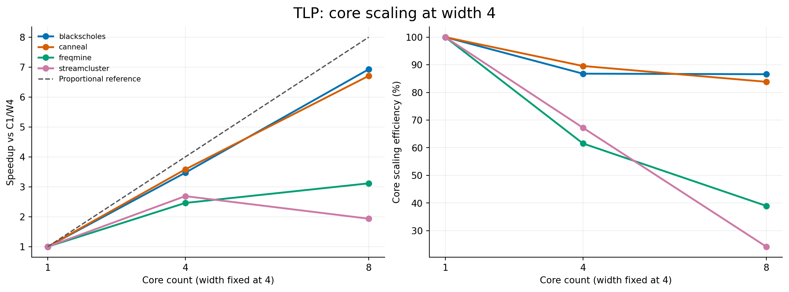

*Figure 1. Core-count speedup and core scaling efficiency; the dashed line is proportional scaling.*

### Speedup and scaling

**Blackscholes** scales from 29.094 ms to 8.380 ms to 4.200 ms: **3.472× at four cores and 6.928× at eight**, retaining 86.6% efficiency at eight cores. Doubling from four to eight cores yields another 1.995× speedup. Committed micro-op count grows only about 0.5% from one to eight cores, so the near-linear trend is accompanied by nearly constant executed work.

**Canneal** reaches **3.583× and 6.708×**, or 83.8% eight-core efficiency. Its low per-core retirement throughput does not prevent good thread scaling: independent threads can make concurrent progress even when each individual thread has limited instruction throughput. This distinction matters when comparing its strong TLP result with its weak width result.

**Freqmine** reaches **2.462× and 3.117×**. Doubling four to eight cores produces only 1.266× more speed. Eight-core efficiency falls to 39.0%; committed micro-op count increases by 9.9% relative to one core, while per-core throughput decreases. More hardware is doing both additional executed work and less work per core-cycle.

**Streamcluster** improves to **2.689× at four cores**, then falls to **1.936× at eight**. C8/W4 takes **38.9% longer than C4/W4**. This is a measured regression, not merely sublinear scaling. Section 7 examines the associated work and memory counters without assigning an unmeasured causal explanation.

### Power, energy and thermal cost

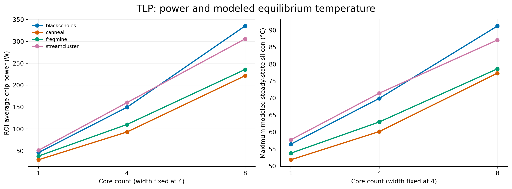

*Figure 3. Absolute chip power and equilibrium silicon temperature in the core sweep.*

At eight cores, power is **7.292×, 7.493×, 6.195× and 5.979×** the one-core power for blackscholes, canneal, freqmine and streamcluster. That cost buys very different amounts of useful runtime reduction. All four use more energy than their one-core baselines at eight cores: **+5.3%, +11.7%, +98.8% and +208.9%**, respectively.

Peak modeled equilibrium temperature rises by **34.76, 25.48, 24.81 and 29.35 °C** from one to eight cores. The hottest case in the entire dataset is blackscholes C8/W4 at **91.19 °C** and **335.18 W**. These are equilibrium model outputs under the assumed package, not measured temperatures at the end of a 4.2 ms execution.

**Answer for TLP:** more cores pay off strongly for blackscholes and canneal in runtime, moderately for freqmine, and only through four cores for streamcluster. Four cores save ROI energy for blackscholes/canneal. Eight cores are a speed-oriented choice for those two workloads, with increased modeled power, energy, area and temperature.

## 4. Instruction-level parallelism: wider pipelines at four cores

| Benchmark | Speedup at 4 | Speedup at 8 | Efficiency at 8 (%) | P₈/P₀ | E₈/E₀ | ΔT₈ (°C) |
| --- | --- | --- | --- | --- | --- | --- |
| blackscholes | 1.957 | 3.212 | 80.3 | 1.796 | 0.559 | 15.21 |
| canneal | 1.070 | 1.096 | 27.4 | 1.044 | 0.953 | 0.42 |
| freqmine | 1.275 | 1.463 | 36.6 | 1.175 | 0.803 | 2.90 |
| streamcluster | 1.324 | 1.173 | 29.3 | 1.282 | 1.092 | 6.14 |

The width sweep uses **C4/W2 as its baseline**. Its eight-wide nominal scale factor is 4, so efficiency here is `S₈/4`, not `S₈/8`.

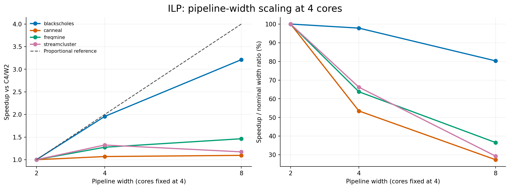

*Figure 2. Width-sweep speedup and speedup divided by the nominal width ratio.*

**Blackscholes** benefits most: W2→W4 gives **1.957×**, and W2→W8 gives **3.212×** speedup. Its 80.3% fraction of proportional width scaling and nearly constant committed work are consistent with substantial exploitable instruction parallelism in this setup. W4→W8 still gives 1.642× speedup.

**Canneal** gains only **1.070× at W4 and 1.096× at W8**. The final doubling delivers just 2.4% additional speed. At W4 it retires about 0.369 μops/core/cycle, versus a four-wide datapath. L1D/L2 demand-miss densities are approximately 23.8/14.0 per thousand architectural instructions, much higher than blackscholes. These observations are consistent with important memory/dependency limits; they do not identify the precise limiting latency or prove bandwidth saturation.

**Freqmine** gains **1.275× at W4 and 1.463× at W8**. Width helps, but the measured gain remains well below proportional scaling. Fixed queues, functional units, dependencies and memory behavior are possible limits that this sweep does not isolate. W4→W8 gives 14.8% more speed for 8.7% more power, reducing energy by about 5.2%.

**Streamcluster** peaks at W4: **1.324×** speedup versus W2. W8 reaches only **1.173×**, taking **12.8% longer than W4**. Its committed micro-op count rises by 13.4% from W4 to W8 while per-core throughput changes by only about 0.5%. The extra retired activity, rather than a substantial throughput improvement, accompanies the runtime regression.

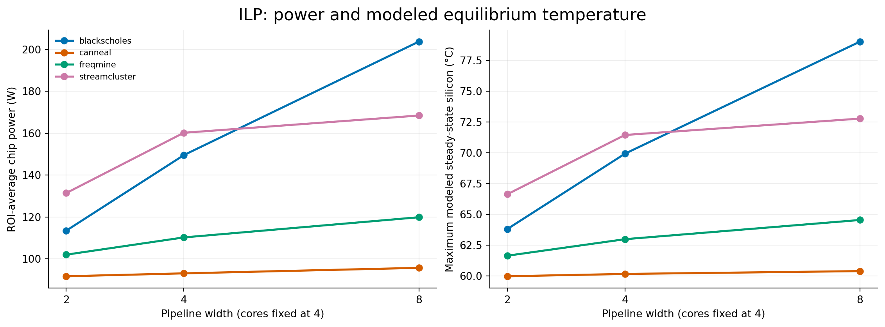

*Figure 4. Power and equilibrium temperature as all seven pipeline widths increase.*

W2→W8 increases average power by **79.6%, 4.4%, 17.5% and 28.2%**, and peak equilibrium temperature by **15.21, 0.42, 2.90 and 6.14 °C** for the four workloads. Energy changes by **−44.1%, −4.7%, −19.7% and +9.2%**. The larger blackscholes power increase is accompanied by much faster completion and less energy. For canneal, tiny extra speed beyond W4 does not offset the extra power: W8 consumes about 0.4% more energy than W4, a small single-run difference that should not be overstated.

**Answer for ILP:** widening helps when the workload can exploit it, most clearly blackscholes. It has diminishing value for freqmine, little value beyond W4 for canneal, and a measurable regression beyond W4 for streamcluster. This experiment changes throughput widths while keeping major queue and FU resources fixed; it does not evaluate fully redesigned commercial two-, four- and eight-wide cores.

## 5. Where does the power go?

### Component accounting without double counting

For every core, the decomposition is **core logic = detailed McPAT Core − Instruction Cache − Data Cache**. L1I/L1D are then added once, along with each shared L2 bank, the equivalent network and the aggregate memory-controller summary. The memory-controller summary is used because McPAT's detailed controller output mixes per-controller area/leakage with aggregate runtime power. Parent totals are never added to their children.

The largest relative difference between the sum of detailed block powers and the printed processor total is **1.23e-06**, consistent with output rounding. All category powers include both runtime dynamic and fixed-reference static power unless explicitly separated.

At the common C4/W4 configuration:

| Benchmark | Core logic W | L1I+D W | Shared L2 W | NoC W | MC W | Chip static % |
| --- | --- | --- | --- | --- | --- | --- |
| blackscholes | 61.23 | 59.27 | 7.41 | 20.84 | 0.77 | 50.97 |
| canneal | 36.05 | 26.41 | 7.47 | 22.05 | 1.08 | 81.89 |
| freqmine | 39.90 | 40.53 | 7.45 | 21.45 | 0.88 | 69.14 |
| streamcluster | 57.38 | 71.00 | 7.75 | 23.30 | 0.76 | 47.57 |

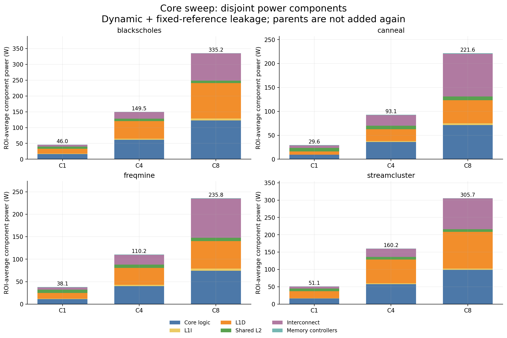

*Figure 7. Disjoint core, cache, network and controller power across the core sweep; axes differ by workload.*

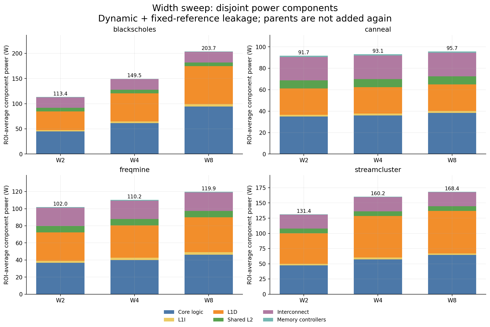

*Figure 8. The same component accounting across the width sweep.*

Core logic and private L1 dominate the baseline cases. For blackscholes, they contribute about **41.0% and 39.6%** of chip power; the network contributes 13.9%. For streamcluster, **L1 alone contributes 44.3%**, exceeding core logic's 35.8%. Canneal's modeled network share is 23.7%, largely leakage. Memory-controller power is small in this on-chip model, which says nothing about excluded off-chip DRAM energy.

These percentages are properties of the chosen mapping. In particular, McPAT estimates each 32 KiB L1D at **47.44 mm²**, versus **3.58 mm²** for each same-capacity L1I. Cache ports, buffers, cycle constraints and analytical implementation assumptions therefore deserve calibration before treating the cache-area or cache-power shares as realistic physical CPU measurements.

### Dynamic versus static

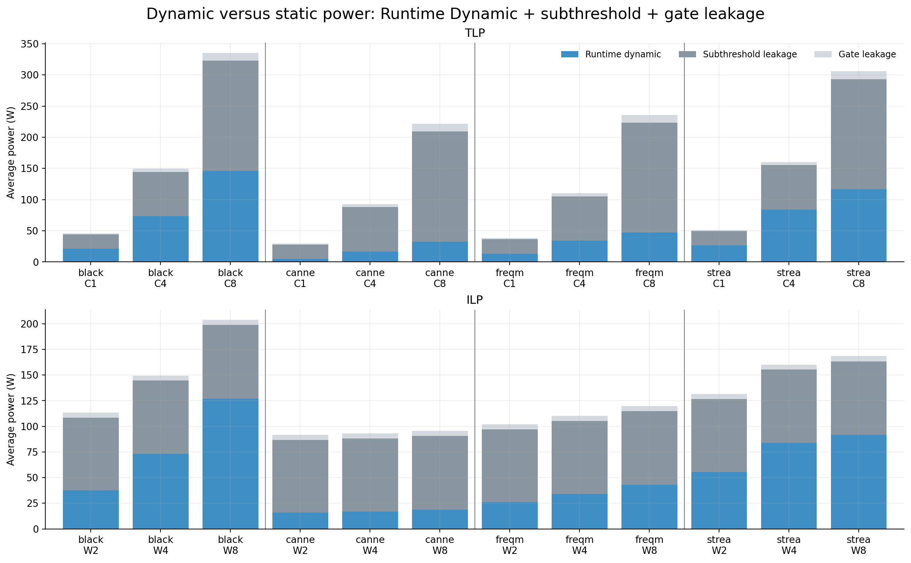

*Figure 9. Runtime dynamic, subthreshold leakage and gate leakage; both sweep panels reuse C4/W4 measurements.*

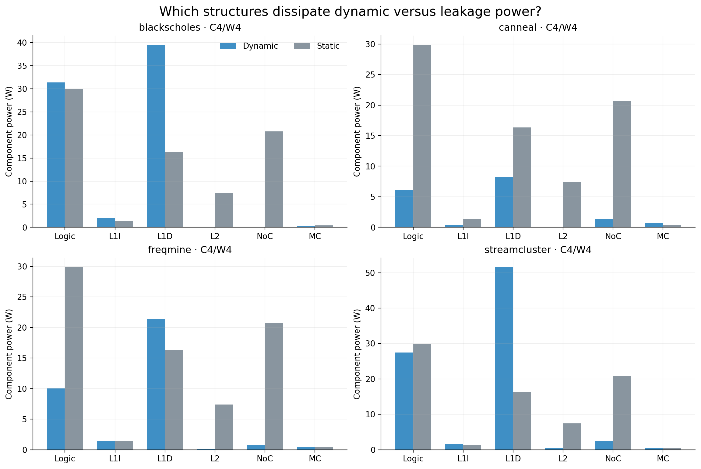

*Figure 10. Per-component dynamic and static power at C4/W4.*

At C4/W4, static power is approximately **76.20 W for every workload**. It accounts for **51.0%** of blackscholes, **81.9%** of canneal, **69.1%** of freqmine and **47.6%** of streamcluster power. Static power does not fall just because a workload retires fewer operations: voltage, hardware and reference leakage temperature remain fixed, with power gating disabled. Canneal therefore has a high leakage fraction despite relatively low dynamic power.

Most runtime dynamic power is in core logic and L1D in this mapping. At C4/W4, L2 and NoC power are largely static: blackscholes has only about **0.010 W L2 dynamic** and **0.093 W NoC dynamic**, compared with **7.40 W and 20.74 W static**. Streamcluster's modeled NoC dynamic is higher, **2.56 W**, but its NoC static remains 20.74 W.

At C8/W4, chip static power is **188.81 W**, accounting for **56.3–85.2%** of total power across these workloads. The equivalent NoC contributes **85.70 W of that static power**. Thus, a large network slice in a stacked plot cannot be read as direct evidence that message traffic is dissipating that much dynamic power.

### Hardware cost and the network assumption

| Configuration | Area (mm²) | Chip static (W) | NoC static (W) | Routers | Directed internal links |
| --- | --- | --- | --- | --- | --- |
| C1/W4 | 191.076 | 24.737 | 5.012 | 7 | 42 |
| C4/W2 | 524.459 | 75.911 | 20.733 | 10 | 90 |
| C4/W4 | 530.250 | 76.203 | 20.742 | 10 | 90 |
| C4/W8 | 550.561 | 76.934 | 20.771 | 10 | 90 |
| C8/W4 | 1061.510 | 188.812 | 85.702 | 14 | 182 |

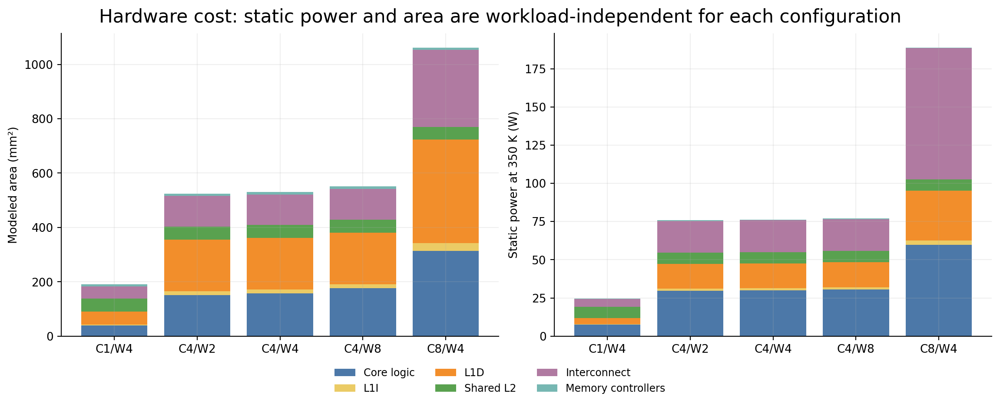

*Figure 18. Area and fixed-reference leakage by disjoint component; all workloads share each configuration’s hardware.*

The simulated SimplePt2Pt network has `N+6` routers/endpoints and a fully connected directed internal topology: 7, 10 and 14 routers, with 42, 90 and 182 directed internal links. The McPAT converter represents it as an **uncalibrated equivalent physical router network**, using port degree, three virtual networks and proxy buffers/flits. As endpoints increase, the modeled router complexity and leakage increase substantially. C1→C8 raises NoC static power **17.1×**, although core count rises 8×. The physical network is not a measured mesh layout, and the lumped HotSpot NoC block is not a recovered wire floorplan.

In contrast, W2→W8 keeps most hardware capacities and functional-unit counts fixed. Modeled chip area increases only **5.0%**, and static power only **1.35%**. This is the cost of the current width mapping and fixed-resource policy, not evidence that a physically validated eight-wide CPU costs only 5% more area than a two-wide CPU. Width also slightly changes equivalent network area through McPAT's geometry approximation, even though gem5's endpoint topology is unchanged.

## 6. Does power grow linearly?

“Linear” can mean either **proportional** (`P = kx`, through the origin) or **affine** (`P = a + bx`, with fixed overhead). These questions need different tests. A total-power ratio below the hardware-count ratio rejects proportional scaling over that interval, but does not by itself reject an affine relationship.

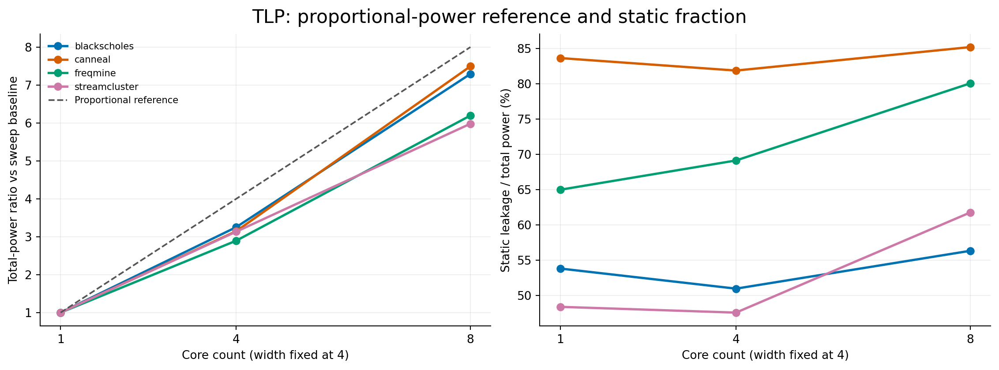

*Figure 5. Core-sweep power normalized to C1/W4, with proportional reference and static fractions.*

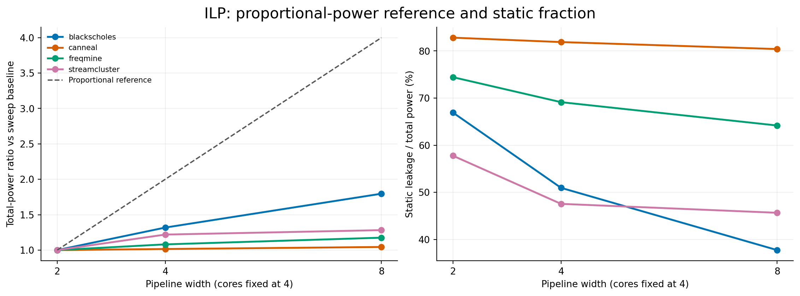

*Figure 6. Width-sweep power normalized to C4/W2, with proportional reference and static fractions.*

**Across C1→C8**, every workload's total-power ratio is below 8. **Across C4→C8**, however, blackscholes, canneal and freqmine increase by **2.242×, 2.381× and 2.139×**, exceeding the 2× increase in cores. Streamcluster increases by 1.908×. One cannot summarize this as power being uniformly sublinear in core count.

An affine relation would have constant incremental watts per added core or width unit. The measured interval slopes are:

| Benchmark | C1→4 W/added core | C4→8 W/added core | W2→4 W/width unit | W4→8 W/width unit |
| --- | --- | --- | --- | --- |
| blackscholes | 34.52 | 46.42 | 18.04 | 13.56 |
| canneal | 21.16 | 32.13 | 0.70 | 0.66 |
| freqmine | 24.05 | 31.40 | 4.12 | 2.41 |
| streamcluster | 36.36 | 36.37 | 14.40 | 2.06 |

Blackscholes, canneal and freqmine have higher incremental watts/core in the C4→C8 interval, consistent with increasing network/static cost and workload-dependent activity. Streamcluster is **almost affine** over these samples: 36.36 versus 36.37 W per added core. It still has poor performance scaling; nearly affine power does not imply efficient scaling.

Every width interval has power elasticity below 1: widening is subproportional in total average power in this fixed-resource model. Canneal is nearly affine with a large fixed-power offset and a small added-width cost. The other workloads have smaller watts/width-unit in W4→W8 than W2→W4, although this does not imply a universal hardware power law.

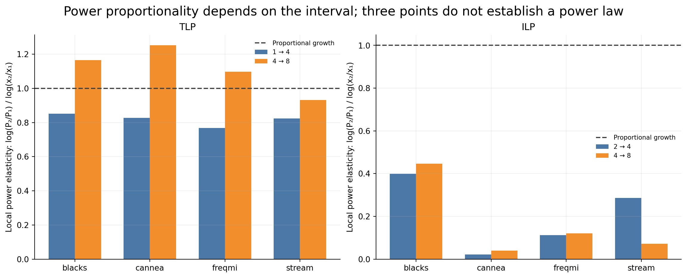

*Figure 17. Interval power elasticity log(P₂/P₁)/log(x₂/x₁); the dashed level 1 denotes proportional growth.*

Only three levels are sampled per sweep, with one observation each. No robust polynomial/power-law fit, significance test or extrapolation beyond this grid is justified. The interval comparisons answer the measured scaling question directly.

## 7. Why do the workloads behave differently?

The following are diagnostic associations. None is a source-level attribution to a particular lock, spin loop or data structure.

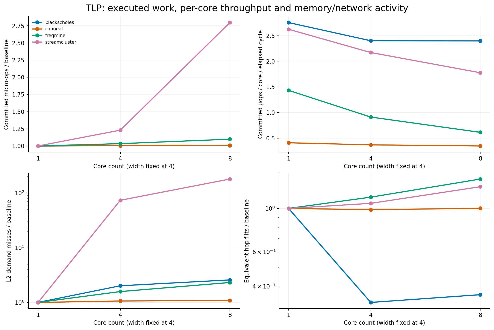

*Figure 15. Core-sweep executed work, per-core retirement throughput, L2 misses and equivalent network hop flits; bottom axes are logarithmic.*

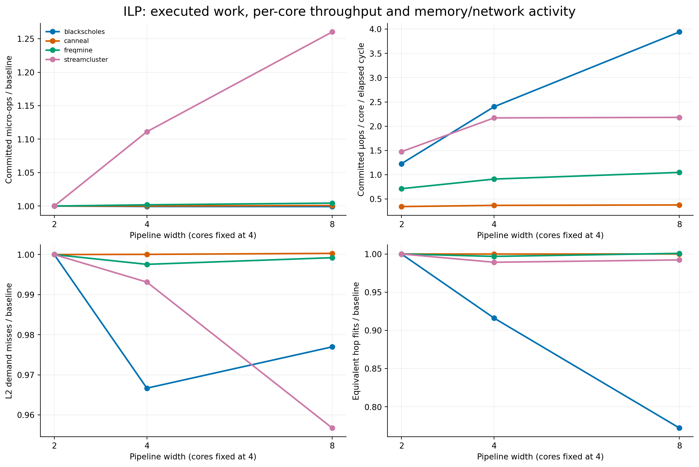

*Figure 16. Width-sweep diagnostics; per-core throughput counts all retired work, including synchronization.*

**Blackscholes:** nearly unchanged committed work accompanies strong core and width scaling. This is the clearest case where additional execution capacity translates into lower time. It has very low L2 demand-miss activity compared with canneal/freqmine, while dynamic power rises as activity is completed faster.

**Canneal:** committed work is almost unchanged across either sweep. At four cores, wall-time-averaged per-core retirement throughput is only about **0.345, 0.369 and 0.378 μops/cycle** at W2, W4 and W8. More width barely changes that throughput; more independent cores still reduce completion time. Its demand-miss activity supports a memory/dependency bottleneck hypothesis, but latency and bandwidth measurements would be needed to separate those causes.

**Freqmine:** per-core throughput decreases as cores increase, and committed micro-op count grows about **9.9%** at eight cores versus one. The eight-core work shares are uneven: core 0 accounts for about **25%** of committed μops, compared with an equal-share 12.5%. That is evidence of uneven retired activity, not a direct measurement of useful-work balance; a thread doing synchronization can also retire many instructions.

### Streamcluster regression: what the counters actually show

| Configuration | Arch inst (B) | Committed μops (B) | μops/core/cycle | L2 misses (M) | Hop flits (M) | Memory requests |
| --- | --- | --- | --- | --- | --- | --- |
| C1/W4 | 1.152 | 1.860 | 2.625 | 0.022 | 343.885 | 21591 |
| C4/W2 | 1.297 | 2.059 | 1.476 | 1.604 | 368.955 | 25563 |
| C4/W4 | 1.482 | 2.288 | 2.171 | 1.593 | 364.968 | 25760 |
| C4/W8 | 1.728 | 2.595 | 2.183 | 1.534 | 366.087 | 26039 |
| C8/W4 | 3.769 | 5.201 | 1.777 | 3.894 | 443.979 | 213362 |

For the core sweep, C1→C8 grows architectural instructions **3.271×** and committed μops **2.796×**. User-mode architectural instructions grow **3.127×**, so kernel execution alone cannot explain the work inflation. At the same time, μops/core/cycle falls from **2.625 to 1.777**. The exact accounting identity is:

`t = committed μops / (core count × clock frequency × wall-time-averaged μops/core/cycle)`.

Thus the measured speedup is consistent with both increased executed work and reduced per-core retirement throughput. It would be incorrect to interpret extra retired instructions as additional useful application work or to “correct” speedup by dividing away this overhead.

For W4→W8, committed μops increase **13.4%**, while throughput changes from **2.171 to 2.183 μops/core/cycle**. This corresponds to about **12.8% more time**, matching the measured regression. L2 demand misses actually decrease slightly in this width interval, while total hop-flit count is nearly unchanged. The observed slowdown therefore cannot be justified by simply claiming that this run has more cache misses or more total network traffic.

Core scaling does increase some memory-system activity: C4→C8 raises memory-controller requests from **25,760 to 213,362** and L2 demand misses from **1.593 M to 3.894 M**. Nevertheless, Ruby L2 demand misses are not equivalent to DRAM requests, and hop-flit counts are not stall cycles. These data alone do not establish bandwidth saturation, false sharing or lock contention. PC/source profiles, synchronization measurements, queue occupancy/latency and bandwidth counters would be appropriate follow-up evidence.

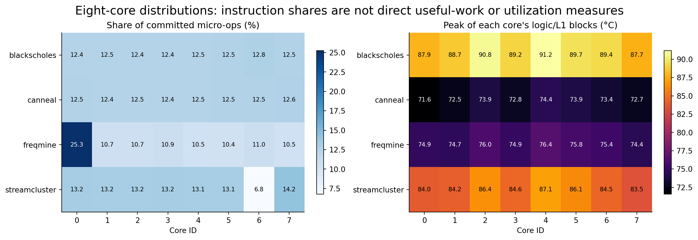

*Figure 22. Eight-core retired-work shares and core-block temperatures; equal instruction shares do not guarantee equal useful progress.*

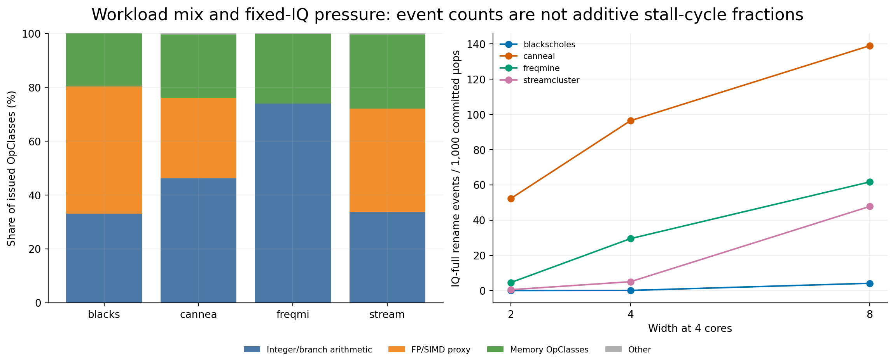

*Figure 23. Issued operation mix and normalized IQ-full rename events; events are not additive stall-cycle fractions.*

The issued-operation mix is based on disjoint OpClass groups. The FP/SIMD category inherits the converter's scalar-equivalent SIMD approximation, including integer SIMD operations. IQ-full rename events grow with width for several workloads while IQ capacity remains 64, consistent with more queue pressure. These event counts do not supply a complete bottleneck breakdown and must not be summed into a percentage of execution time.

## 8. Energy and the speed–power–temperature tradeoff

Average watts answer a cooling/supply question; joules answer the cost of finishing the ROI. They can rank configurations differently. A point with higher average power can save energy if it completes sufficiently faster.

| Sweep | Benchmark | Fastest | Lowest energy | Lowest EDP | E₄/E₀ | E₈/E₀ |
| --- | --- | --- | --- | --- | --- | --- |
| TLP | blackscholes | C8/W4 | C4/W4 | C8/W4 | 0.937 | 1.053 |
| TLP | canneal | C8/W4 | C4/W4 | C8/W4 | 0.878 | 1.117 |
| TLP | freqmine | C8/W4 | C1/W4 | C4/W4 | 1.176 | 1.988 |
| TLP | streamcluster | C4/W4 | C1/W4 | C4/W4 | 1.165 | 3.089 |
| ILP | blackscholes | C4/W8 | C4/W8 | C4/W8 | 0.674 | 0.559 |
| ILP | canneal | C4/W8 | C4/W4 | C4/W8 | 0.949 | 0.953 |
| ILP | freqmine | C4/W8 | C4/W8 | C4/W8 | 0.847 | 0.803 |
| ILP | streamcluster | C4/W4 | C4/W4 | C4/W4 | 0.921 | 1.092 |

Each “best” is **within the indicated sweep**, with no imposed temperature, area or power budget. EDP is one chosen objective, not a universally correct weighting. The canneal width-sweep energy difference between W4 and W8 is particularly small and has no replication-based uncertainty estimate.

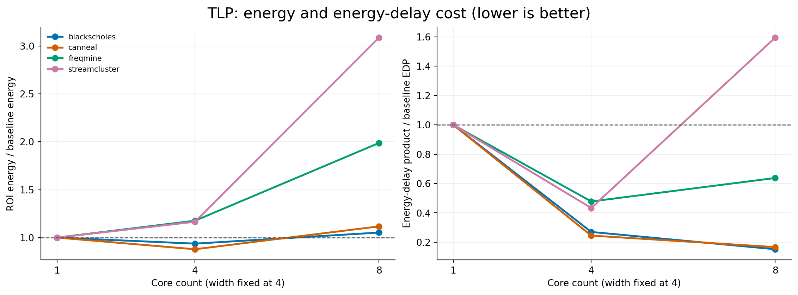

*Figure 11. Core-sweep normalized ROI energy and energy-delay product; lower is better.*

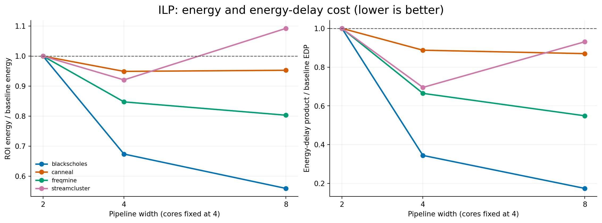

*Figure 12. Width-sweep normalized ROI energy and energy-delay product.*

At C4/W4 versus C1/W4, blackscholes and canneal save **6.3% and 12.2%** energy, whereas freqmine and streamcluster consume **17.6% and 16.5%** more. At C8/W4, all four exceed baseline energy. Blackscholes/canneal still improve EDP at eight cores because of their large time reductions. Freqmine's EDP is best at four cores in the core sweep; streamcluster's eight-core EDP is worse than even its one-core baseline.

In the width sweep, W8 saves considerable energy for blackscholes and some for freqmine; canneal has its minimum at W4; streamcluster W8 uses more energy than both W2 and W4. Compared with C4/W4, streamcluster C8/W4 is worse in runtime, average power, energy and peak equilibrium temperature, as is C4/W8. C4/W4 therefore dominates those two sampled alternatives on these objectives.

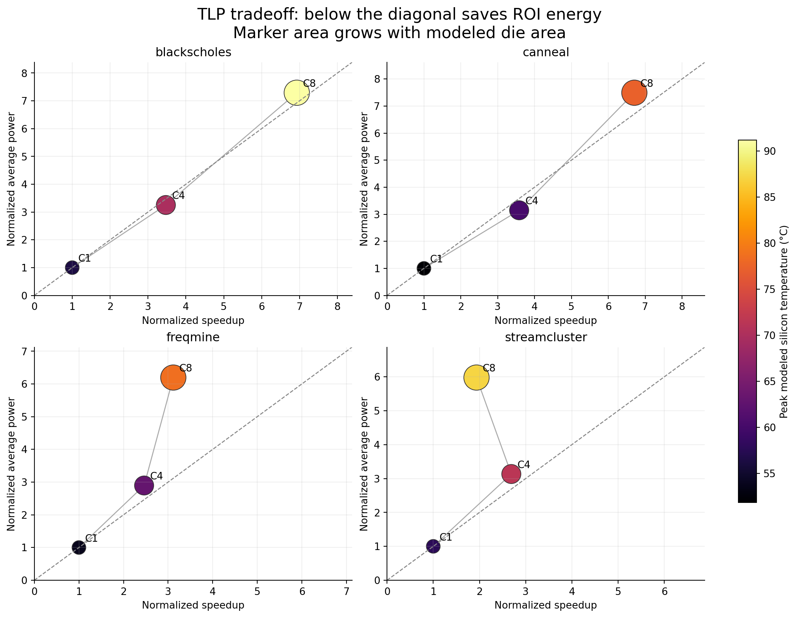

*Figure 13. Core-sweep speedup–power tradeoffs. Points below the diagonal save ROI energy; color encodes temperature and marker area grows with die area.*

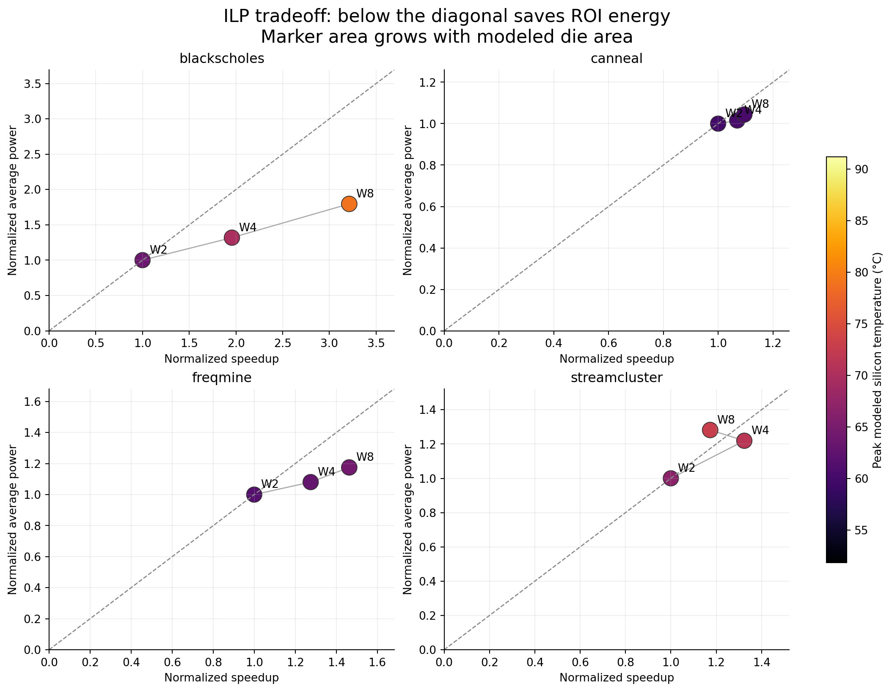

*Figure 14. Width-sweep tradeoffs using the independent C4/W2 baseline.*

Across the five measured configurations, blackscholes has its shortest time at C8/W4 but its lowest energy and EDP at C4/W8. Canneal's shortest time and lowest EDP occur at C8/W4, with lowest energy at C4/W4. Freqmine is fastest at C8/W4, most energy-efficient at C1/W4, and lowest in EDP at C4/W8. Streamcluster is fastest and lowest in EDP at C4/W4, with lowest energy at C1/W4. These choices are conditional on this model and the observed single runs.

### Optional equal-weight workload summary

| Setting | GM speedup | GM power ratio | GM energy ratio | GM EDP ratio |
| --- | --- | --- | --- | --- |
| TLP C4 | 3.013 | 3.104 | 1.031 | 0.342 |
| TLP C8 | 4.092 | 6.707 | 1.639 | 0.401 |
| ILP W4 | 1.371 | 1.152 | 0.840 | 0.613 |
| ILP W8 | 1.568 | 1.296 | 0.827 | 0.527 |

These are **geometric means of per-workload normalized ratios**, with equal weight per benchmark. They do not describe an actual simultaneously executing chip workload, a sum of application times or a population confidence interval. Celsius temperatures are not geometrically averaged. The core-sweep mean hides very different application behavior: C8 achieves 4.092× geometric-mean speedup but 1.639× geometric-mean energy. W8 achieves 1.568× speedup and 0.827× energy relative to W2, with most width benefit concentrated in blackscholes.

## 9. Temperature: interpretation and spatial patterns

The [thermal model](../../configs/hotspot/model-v1.json) applies each block's **ROI-average total power indefinitely** and solves for steady state. Ambient is **45 °C**, silicon thickness 0.15 mm, thermal interface thickness 20 μm, spreader side 50 mm, heat-sink side 70 mm, and convection resistance 0.1 K/W. These settings remain fixed across cases.

The square die uses the sum of disjoint McPAT block areas, with no added whitespace. A deterministic recursive bisection places core logic, L1I, L1D, two L2 banks, one whole-network block and one aggregate memory-controller block. Area and placement change across configurations, so the temperature comparison includes both different power and different surrogate geometry.

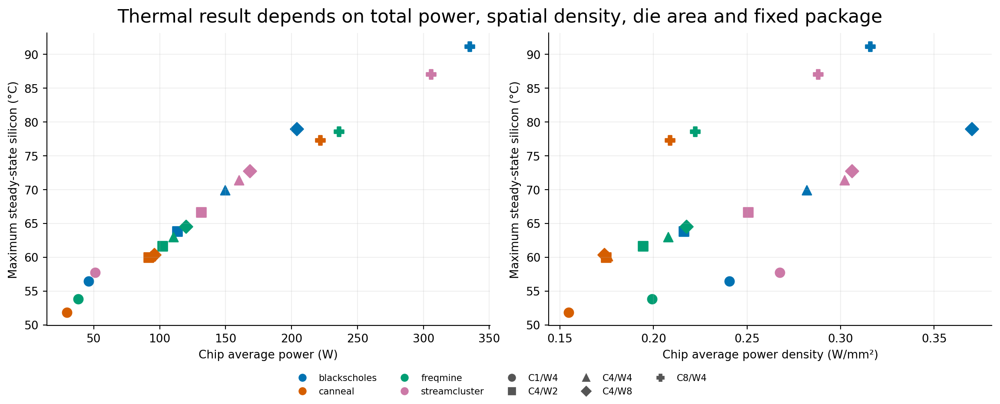

*Figure 19. All 20 cases: equilibrium peak temperature versus total power and chip-average power density.*

Temperature rises monotonically with both cores and width in every workload, but is not proportional to either hardware parameter. Higher total power raises the heat-removal burden; block density, adjacency, die area and package spreading also matter. Chip-average W/mm² alone does not determine the hottest block. For example, blackscholes C1/W4 has about **0.241 W/mm² and 56.43 °C**, while C4/W2 has a lower chip-average **0.216 W/mm²** but a higher peak **63.81 °C**, under the same package assumptions.

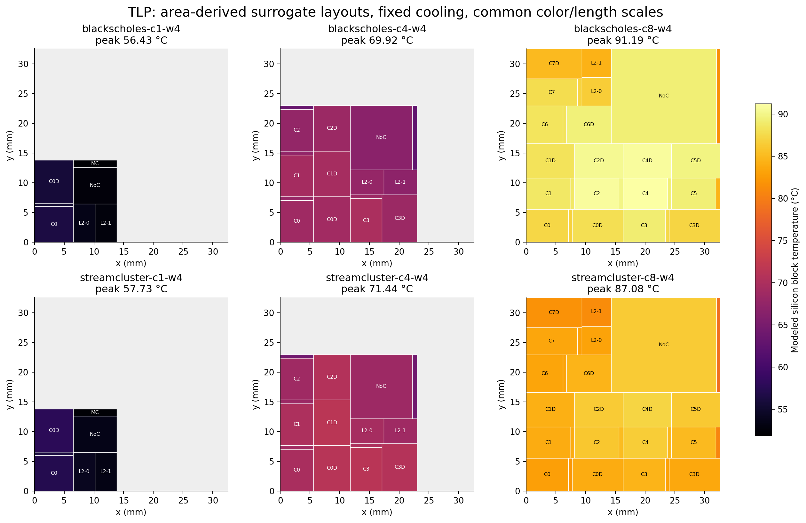

*Figure 20. Example core-sweep thermal maps for blackscholes and streamcluster, with common millimeter and temperature scales. Gray is outside the modeled die.*

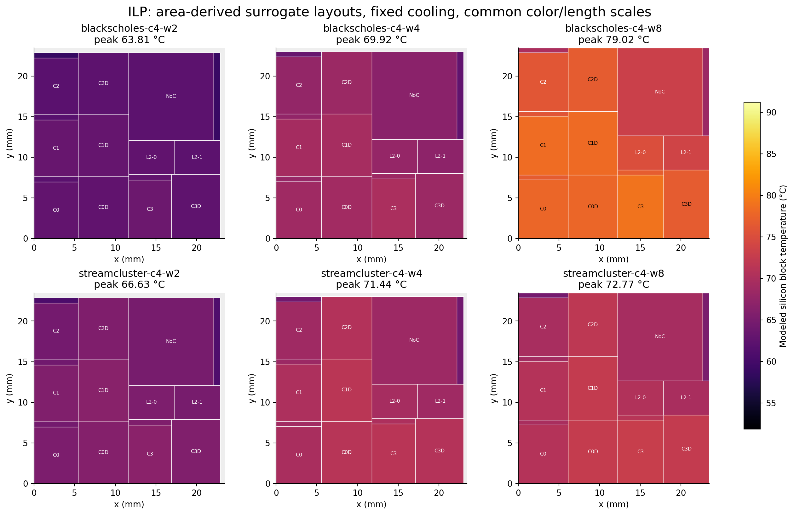

*Figure 21. Example width-sweep thermal maps under the same surrogate placement rule and cooling.*

Map labels `Ck`, `CkI` and `CkD` denote core k's logic, L1I and L1D; `L2-0/1`, `NoC` and `MC` denote shared blocks. Small blocks may be unlabeled. The hottest named block can change: blackscholes C8/W4 peaks in core 4 logic, streamcluster C8/W4 in core 4 L1D, and canneal/freqmine C8/W4 in the **lumped NoC**. This last result is particularly dependent on the surrogate network leakage and placement.

The full ROI durations range from approximately **4.2 to 659.2 ms**. These steady-state maps do not predict the temperature reached after those short individual executions. No transient power trace or initial temperature history was used. Warm-up of simulated CPU/cache state and thermal warm-up are different concepts: excluding microarchitectural startup does not by itself make an equilibrium temperature physically occur during the ROI. Absolute values are not a safety-limit assessment, and within-block hotspots are unresolved.

## 10. Reliability, model limitations and what remains unresolved

The [validation record](data/validation.json) records 20 completed cases, 24 normalized sweep points and **260 SHA-256-hashed source artifacts**. The analysis rechecks stage provenance and the gem5→McPAT mapping, uses the completed ROI's statistics dump rather than arbitrary intermediate signal-triggered dumps, verifies cache hit/miss accounting and conserves detailed chip power. Two cases, canneal C1/W4 and freqmine C1/W4, have documented gem5 cycle-counter bookkeeping notes; exact tick duration is still used, with active cycles checked against elapsed time.

The following materially limit the conclusions:

1. **Single observation per configuration.** Guest scheduling, synchronization and initialization can influence results. Small differences, particularly canneal's width-energy ranking, need repetitions before being treated as stable design preferences.
2. **Cold-start full-ROI methodology.** O3 structures and caches are not preconditioned by detailed pre-ROI execution. The direction and magnitude of this bias can vary by workload and hardware size. Current data do not establish that warm-up would preserve every ranking.
3. **Physical timing is not validated.** Every McPAT run reports two `L2cache array structure cannot satisfy latency constraint` warnings, one per L2 bank. See [the complete warning list](data/mcpat_warnings.csv). gem5 timing is still the configured simulation timing; the analytical cache does not establish that those constraints are physically realizable at the modeled clock.
4. **Approximate power/activity mapping.** SIMD uses scalar-equivalent FPU activity; several register/storage structures lack separate representation; rename/CDB activity uses proxies. Cache demand read/write splitting is estimated, and explicit fill/writeback/coherence/directory activity is incomplete. Low modeled L2 dynamic power must be interpreted in that context. Details are recorded in the [McPAT policy](../../configs/mcpat/model-v1.json).
5. **Uncalibrated physical implementation.** Cache area/ports/buffers, equivalent NoC topology and controller models require calibration. Static and area growth, and hence thermal outcomes, strongly depend on them. NoC physical links and HotSpot adjacency are approximations of an abstract performance model.
6. **Fixed leakage and restricted energy scope.** Leakage is fixed at 350 K even when HotSpot predicts a different temperature. There is no electrothermal feedback, DVFS, gating, throttling or off-chip DRAM energy. Energy and EDP inherit these exclusions.
7. **Surrogate steady-state thermal model.** Power is spatially coarse and constant in time; geometry and cooling are assumed. The model does not supply transient temperatures, fine hotspots or a calibrated real package.
8. **Limited design/workload coverage.** Four `simsmall` workloads and two one-dimensional sweeps do not establish universal multicore scaling or the best joint core/width configuration. Architecture changes such as larger IQs, bandwidth or different network topologies were not tested.

The data support the observed speedup/regression patterns and the explicitly modeled cost tradeoffs. They do not yet establish exact source-level causes, manufacturing feasibility or real-chip temperature predictions.

## 11. Next study: a controlled warm-up comparison

No warm-up simulations were launched as part of this analysis. Keep this result set and its policies intact as the non-warm-up reference.

For the primary follow-up, keep **the same full `WORKBEGIN`→`WORKEND` ROI**, switch to the target O3 configuration **before `WORKBEGIN`**, run the selected pre-ROI initialization in detailed mode, and reset only statistics at `WORKBEGIN`. Verify that all target structures actually retain state into measurement and document exactly which pre-ROI interval was executed. Initialization is not automatically representative of steady-state ROI behavior; inspect misses/throughput over time or test more than one preconditioning interval where practical.

The current saved checkpoints are **at `WORKBEGIN`**, so they cannot recreate execution that happened earlier. A full-ROI, preconditioned run needs an earlier checkpoint or a fresh prepare path before the intended warm-up region. Existing at-ROI checkpoints can support warm-up **inside** the ROI followed by measuring the suffix, but that is a different experiment: work has already been consumed, so its elapsed time cannot be compared directly with this full-ROI baseline or called full-ROI speedup.

Use fresh result/checkpoint roots and explicit new policy identities. Preserve all five hardware configurations, four inputs, worker counts, frequency/voltage and ROI definition. Widths may share a compatible architectural fast-forward checkpoint at the same core/thread count, but target-specific microarchitectural state should be warmed for each target configuration. Checkpoint compatibility must be validated explicitly.

For each matched case, report `warm/full-ROI time ÷ cold/full-ROI time`, changes in demand misses, throughput, executed instruction counts, modeled dynamic power/energy and equilibrium temperature. Recompute both sweep speedups relative to their own warm baseline. If power/floorplan modeling is revised after calibration, reprocess **both** reference and warm datasets with the same revised models in separate outputs, so warm-up and model changes are not conflated. Repetitions are especially valuable for streamcluster's regressions and small canneal differences.

## 12. Reproduce, inspect and share

From the repository root, with completed `results/v1` artifacts and the same tool/model revisions:

```bash
python3 -m venv .venv-analysis
.venv-analysis/bin/python -m pip install -r requirements-analysis.txt
.venv-analysis/bin/python scripts/analyze_non_warm_up.py
```

The script validates existing results, regenerates the CSVs, plots, offline interactive HTML and this report. It **does not run gem5, McPAT or HotSpot**, and writes analysis artifacts only. `--results-root` and `--output-dir` select alternative artifact locations; this report specifically requires the current four-workload non-warm-up matrix and matching model provenance. The original simulation artifacts and compatible binaries must be available for a full rerun of the analysis.

The report's current analysis environment is Python **3.10.12**, NumPy **2.2.6**, pandas **2.3.3**, Matplotlib **3.10.9**, and Plotly **7.1.0**. Input policy SHA-256 is `74504ab0c7ab16ef80473108cb3ff2fb2ffc5e0b69d2fd8043d414206ff1adec`. Tool commits:

| Tool | Recorded commit |
| --- | --- |
| gem5 | `e97d8fbfbe4ff549b2c90183956f719ada856756` |
| McPAT | `74d4759f3ba2dff8f5a69e07a68efdb46b42fb8c` |
| HotSpot | `f18831e48cef5d62580585cca0d7fab6c71bc3cc` |

Keep this report with its sibling `figures/`, `data/` and interactive HTML file under `reports/non_warm_up/`. Preserve the repository structure for links to configuration and script sources. Raw multi-gigabyte checkpoints are unnecessary for reading the report. For independent regeneration, provide the hashed source artifacts listed in [input_sha256.json](data/input_sha256.json), the matching configuration/converter sources and recorded tool revisions. Intermediate CSVs support independent metric checks without running the simulators. The HTML bundles Plotly and opens offline; static plots need no JavaScript.

### Complete case measurements

Values below are rounded for readability; CSVs retain additional digits. Temperature is maximum steady-state silicon-block temperature, with 0.01 K precision in the original HotSpot text output. Hardware area for each configuration is in Section 5.

| Case | ROI (ms) | Dynamic (W) | Static (W) | Total (W) | Energy (J) | Tmax (°C) |
| --- | --- | --- | --- | --- | --- | --- |
| blackscholes-c1-w4 | 29.094 | 21.230 | 24.737 | 45.967 | 1.337 | 56.43 |
| blackscholes-c4-w2 | 16.397 | 37.517 | 75.911 | 113.428 | 1.860 | 63.81 |
| blackscholes-c4-w4 | 8.380 | 73.315 | 76.203 | 149.518 | 1.253 | 69.92 |
| blackscholes-c4-w8 | 5.104 | 126.806 | 76.934 | 203.740 | 1.040 | 79.02 |
| blackscholes-c8-w4 | 4.200 | 146.368 | 188.812 | 335.180 | 1.408 | 91.19 |
| canneal-c1-w4 | 356.355 | 4.833 | 24.737 | 29.570 | 10.537 | 51.85 |
| canneal-c4-w2 | 106.387 | 15.747 | 75.911 | 91.658 | 9.751 | 59.97 |
| canneal-c4-w4 | 99.459 | 16.854 | 76.203 | 93.057 | 9.255 | 60.16 |
| canneal-c4-w8 | 97.103 | 18.751 | 76.934 | 95.685 | 9.291 | 60.39 |
| canneal-c8-w4 | 53.126 | 32.756 | 188.812 | 221.568 | 11.771 | 77.33 |
| freqmine-c1-w4 | 659.217 | 13.324 | 24.737 | 38.061 | 25.090 | 53.79 |
| freqmine-c4-w2 | 341.468 | 26.069 | 75.911 | 101.980 | 34.823 | 61.64 |
| freqmine-c4-w4 | 267.772 | 34.011 | 76.203 | 110.214 | 29.512 | 62.98 |
| freqmine-c4-w8 | 233.350 | 42.921 | 76.934 | 119.855 | 27.968 | 64.54 |
| freqmine-c8-w4 | 211.514 | 46.988 | 188.812 | 235.800 | 49.875 | 78.60 |
| streamcluster-c1-w4 | 235.913 | 26.388 | 24.737 | 51.125 | 12.061 | 57.73 |
| streamcluster-c4-w2 | 116.151 | 55.489 | 75.911 | 131.400 | 15.262 | 66.63 |
| streamcluster-c4-w4 | 87.719 | 83.994 | 76.203 | 160.197 | 14.052 | 71.44 |
| streamcluster-c4-w8 | 98.987 | 91.500 | 76.934 | 168.434 | 16.673 | 72.77 |
| streamcluster-c8-w4 | 121.859 | 116.885 | 188.812 | 305.697 | 37.252 | 87.08 |

### Data files

| File | Contents |
| --- | --- |
| [summary.csv](data/summary.csv) | 20 unique cases: time, power, temperature, area, energy and diagnostic counters |
| [sweeps.csv](data/sweeps.csv) | 24 normalized rows with explicit sweep/baseline identity |
| [power_components.csv](data/power_components.csv) | Disjoint component area, dynamic/static power and chip share |
| [per_core.csv](data/per_core.csv) | Per-core retired work, throughput, power and temperature |
| [thermal_blocks.csv](data/thermal_blocks.csv) | Block geometry, power and temperature for every case |
| [power_scaling_intervals.csv](data/power_scaling_intervals.csv) | Adjacent-setting slopes, elasticity and speedup |
| [mcpat_warnings.csv](data/mcpat_warnings.csv) | All 40 recorded L2 timing warnings |
| [validation.json](data/validation.json) | Verification summary, policy/tool versions and analysis-source hash |
| [input_sha256.json](data/input_sha256.json) | Source artifact paths and hashes |

### Figure download index

PNG is convenient for Markdown; SVG and PDF preserve vector graphics for presentations and papers. Independent panel axes are labeled; use the common-color-scale floorplans when comparing thermal maps.

| Figure | Raster | Vector | Document |
| --- | --- | --- | --- |
| 01_tlp_speedup | [PNG](figures/01_tlp_speedup.png) | [SVG](figures/01_tlp_speedup.svg) | [PDF](figures/01_tlp_speedup.pdf) |
| 02_ilp_speedup | [PNG](figures/02_ilp_speedup.png) | [SVG](figures/02_ilp_speedup.svg) | [PDF](figures/02_ilp_speedup.pdf) |
| 03_tlp_power_temperature | [PNG](figures/03_tlp_power_temperature.png) | [SVG](figures/03_tlp_power_temperature.svg) | [PDF](figures/03_tlp_power_temperature.pdf) |
| 04_ilp_power_temperature | [PNG](figures/04_ilp_power_temperature.png) | [SVG](figures/04_ilp_power_temperature.svg) | [PDF](figures/04_ilp_power_temperature.pdf) |
| 05_tlp_normalized_power | [PNG](figures/05_tlp_normalized_power.png) | [SVG](figures/05_tlp_normalized_power.svg) | [PDF](figures/05_tlp_normalized_power.pdf) |
| 06_ilp_normalized_power | [PNG](figures/06_ilp_normalized_power.png) | [SVG](figures/06_ilp_normalized_power.svg) | [PDF](figures/06_ilp_normalized_power.pdf) |
| 07_tlp_component_power | [PNG](figures/07_tlp_component_power.png) | [SVG](figures/07_tlp_component_power.svg) | [PDF](figures/07_tlp_component_power.pdf) |
| 08_ilp_component_power | [PNG](figures/08_ilp_component_power.png) | [SVG](figures/08_ilp_component_power.svg) | [PDF](figures/08_ilp_component_power.pdf) |
| 09_dynamic_static_power | [PNG](figures/09_dynamic_static_power.png) | [SVG](figures/09_dynamic_static_power.svg) | [PDF](figures/09_dynamic_static_power.pdf) |
| 10_component_dynamic_static | [PNG](figures/10_component_dynamic_static.png) | [SVG](figures/10_component_dynamic_static.svg) | [PDF](figures/10_component_dynamic_static.pdf) |
| 11_tlp_energy_edp | [PNG](figures/11_tlp_energy_edp.png) | [SVG](figures/11_tlp_energy_edp.svg) | [PDF](figures/11_tlp_energy_edp.pdf) |
| 12_ilp_energy_edp | [PNG](figures/12_ilp_energy_edp.png) | [SVG](figures/12_ilp_energy_edp.svg) | [PDF](figures/12_ilp_energy_edp.pdf) |
| 13_tlp_tradeoff | [PNG](figures/13_tlp_tradeoff.png) | [SVG](figures/13_tlp_tradeoff.svg) | [PDF](figures/13_tlp_tradeoff.pdf) |
| 14_ilp_tradeoff | [PNG](figures/14_ilp_tradeoff.png) | [SVG](figures/14_ilp_tradeoff.svg) | [PDF](figures/14_ilp_tradeoff.pdf) |
| 15_tlp_work_diagnostics | [PNG](figures/15_tlp_work_diagnostics.png) | [SVG](figures/15_tlp_work_diagnostics.svg) | [PDF](figures/15_tlp_work_diagnostics.pdf) |
| 16_ilp_work_diagnostics | [PNG](figures/16_ilp_work_diagnostics.png) | [SVG](figures/16_ilp_work_diagnostics.svg) | [PDF](figures/16_ilp_work_diagnostics.pdf) |
| 17_power_elasticity | [PNG](figures/17_power_elasticity.png) | [SVG](figures/17_power_elasticity.svg) | [PDF](figures/17_power_elasticity.pdf) |
| 18_area_and_static_cost | [PNG](figures/18_area_and_static_cost.png) | [SVG](figures/18_area_and_static_cost.svg) | [PDF](figures/18_area_and_static_cost.pdf) |
| 19_temperature_power_density | [PNG](figures/19_temperature_power_density.png) | [SVG](figures/19_temperature_power_density.svg) | [PDF](figures/19_temperature_power_density.pdf) |
| 20_tlp_thermal_floorplans | [PNG](figures/20_tlp_thermal_floorplans.png) | [SVG](figures/20_tlp_thermal_floorplans.svg) | [PDF](figures/20_tlp_thermal_floorplans.pdf) |
| 21_ilp_thermal_floorplans | [PNG](figures/21_ilp_thermal_floorplans.png) | [SVG](figures/21_ilp_thermal_floorplans.svg) | [PDF](figures/21_ilp_thermal_floorplans.pdf) |
| 22_per_core_work_and_temperature | [PNG](figures/22_per_core_work_and_temperature.png) | [SVG](figures/22_per_core_work_and_temperature.svg) | [PDF](figures/22_per_core_work_and_temperature.pdf) |
| 23_mix_and_iq_pressure | [PNG](figures/23_mix_and_iq_pressure.png) | [SVG](figures/23_mix_and_iq_pressure.svg) | [PDF](figures/23_mix_and_iq_pressure.pdf) |
