# Warm-up AI analysis: full-ROI multicore evaluation

All **20 warm-up cases** completed gem5, McPAT and HotSpot and passed artifact/provenance checks. This study runs the same four PARSEC 3.0 `simsmall` workloads and five hardware configurations as the [non-warm-up reference](../non_warm_up/non_warm_up_AI_analysis.md). There is one observation per scenario/configuration. The [matched comparison](../warm_up_comparison/warm_up_vs_non_warm_up_AI_analysis.md) explains which conclusions change and why single-run effects must not be treated as cache-only causation.

**Main findings:** core scaling remains strongest for blackscholes and canneal. Freqmine has diminishing core returns. Streamcluster still reaches its best core-sweep runtime at four cores, but its best measured width is now eight. Blackscholes is fastest at width four within its width sweep: its eight-wide case has much more quiescent time. More hardware is therefore not uniformly faster, hotter or higher in average power in these particular runs. Model-dependent energy and thermal costs must be read alongside simulated runtime.

## 1. Method and scope

The [warm-up policy](../../configs/experiment-warmup.json) uses an earlier architectural checkpoint at the PARSEC launch marker. Restoring switches to the target O3 configuration, runs the launcher and application initialization in detailed mode, captures the excluded interval at `WORKBEGIN`, resets statistics only, and measures the **entire `WORKBEGIN`→`WORKEND` ROI**. O3/cache state is retained; there is no second CPU switch at ROI entry. This is pre-ROI initialization conditioning, not a fixed-length in-ROI warm-up and not a demonstrated convergence to steady-state application behavior.

Completion means that the hooked ROI was captured. Simulation stops at `WORKEND`, so this analysis does not independently establish benchmark output checks that may run afterward.

The core sweep is C1/C4/C8 at W4; the width sweep is W2/W4/W8 at C4. Baselines are **warm C1/W4** and **warm C4/W2**, independently for each workload. C4/W4 is shared, giving 20 actual measurements and 24 normalized sweep rows. Worker count follows core count, with one hardware thread per core. Fetch/decode/rename/dispatch/issue/writeback/commit widths change together; FU counts and major queue capacities remain fixed. No unmeasured C8/W8 result is implied.

Requested frequency is 3 GHz, represented by 333 ticks/cycle at 1 THz (approximately 3.003003 GHz); voltage is 1 V. The 45 nm McPAT model uses ROB 192, IQ 64 split into two 32-entry proxies, fixed FU counts, 256 integer/FP registers, LQ/SQ 32, private 32 KiB L1I/D per core, two shared 1 MiB L2 banks and dual-channel DDR4. Added cores also add private cache and network endpoints; this is not an iso-area comparison.

The same [power](../../configs/mcpat/model-v1.json) and [thermal](../../configs/hotspot/model-v1.json) model files are used in both scenarios. Paired resolved O3/cache/memory configurations, area, reference leakage, clocks, floorplans and thermal configs match; see [hardware checks](../warm_up_comparison/data/hardware_checks.csv). Changing pre-ROI execution can still change guest scheduling/history at ROI entry. These are matched-policy measurements, not identical architectural states with only cache contents altered.

## 2. Metrics

| Metric | Definition |
| --- | --- |
| ROI time | Exact measured tick difference divided by tick frequency; excludes boot and initialization |
| Speedup | Own scenario's smallest sweep configuration time divided by target time |
| Core scaling efficiency | Speedup divided by core-count ratio |
| Width scaling fraction | Speedup divided by width ratio; a proportional reference, not a strict upper bound |
| Average chip power | McPAT Runtime Dynamic + Subthreshold Leakage + Gate Leakage |
| ROI energy | Average chip power × measured ROI time |
| Normalized energy / EDP | Power ratio / speedup; power ratio / speedup² |
| Temperature | Maximum named silicon-block equilibrium temperature under sustained ROI-average power |
| Wall throughput | Committed μops / (cores × elapsed cycles) |
| Recorded active fraction | Sum(numCycles − idleCycles) / (cores × elapsed cycles) |
| Active-cycle throughput | Committed μops / sum(numCycles − idleCycles) |

Whole modeled chip power includes caches, equivalent NoC and on-chip controllers/PHY; it excludes DRAM chips, board power and peripherals. Leakage stays fixed at 350 K, with no gating, DVFS or electrothermal feedback. Temperature changes use °C differences, not Celsius percentages. Each case has one run; plots have no statistical error bars. Retired instructions are not a direct measure of useful work, and queue-event counters are not additive stall-cycle fractions.

## 3. Thread-level parallelism

| Workload | Speedup at 4 | Speedup at 8 | Scale fraction at 8 (%) | P₈/P₀ | E₈/E₀ | ΔT₈ (°C) |
| --- | --- | --- | --- | --- | --- | --- |
| blackscholes | 3.890 | 7.014 | 87.67 | 7.329 | 1.045 | 35.16 |
| canneal | 3.670 | 5.719 | 71.49 | 7.352 | 1.286 | 24.98 |
| freqmine | 2.458 | 3.165 | 39.56 | 6.212 | 1.963 | 24.87 |
| streamcluster | 2.558 | 2.175 | 27.19 | 6.056 | 2.784 | 29.74 |

Here the subscript 8 means eight cores and the baseline is warm C1/W4. Blackscholes reaches **7.014×** speedup at eight cores (87.7% efficiency), while canneal reaches **5.719×** (71.5%). Blackscholes C4→C8 adds 1.803× speed; canneal adds 1.558×. Freqmine reaches **3.165×**, with only 39.6% eight-core efficiency. Streamcluster reaches **2.558× at C4**, then drops to **2.175× at C8**; eight cores take about 17.6% longer than four in this sweep.

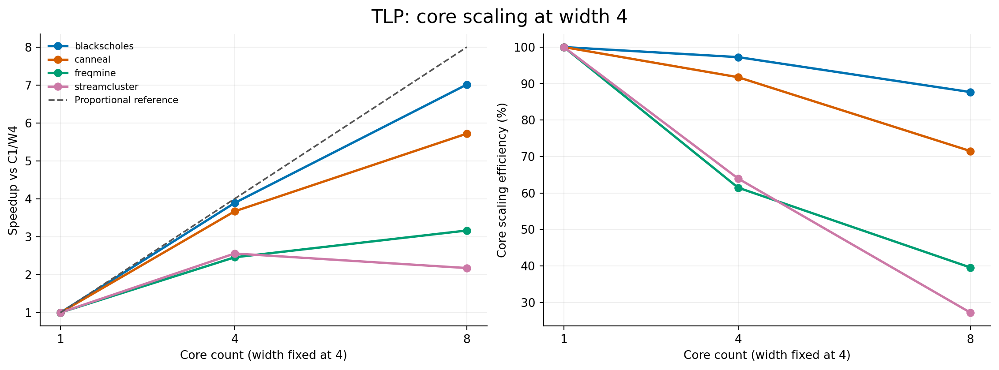

*Warm figure 1. Core-sweep speedup and scaling efficiency.*

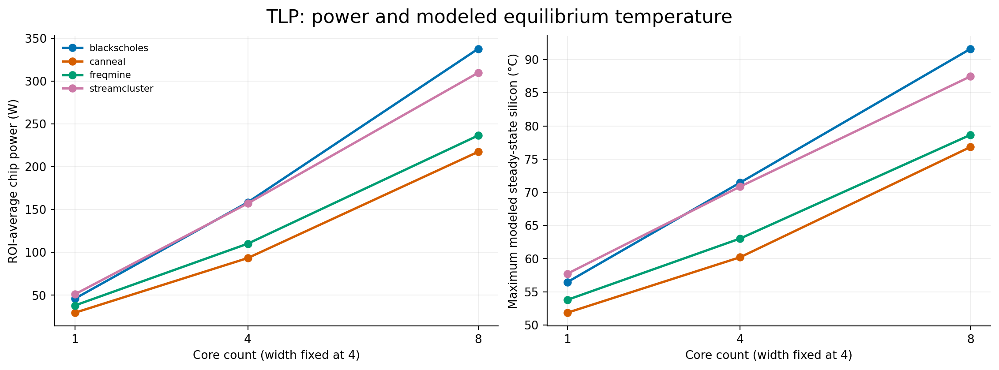

*Warm figure 3. Chip power and equilibrium temperature across core counts.*

At eight cores, chip power is 7.329×/7.352×/6.212×/6.056× the one-core power for blackscholes/canneal/freqmine/streamcluster. ROI energy is **1.045×/1.286×/1.963×/2.784×** the one-core energy. Four cores save energy for blackscholes and canneal; eight cores exceed one-core energy for all four workloads. Strong speedup can improve EDP despite higher energy, but streamcluster C8 has worse EDP than its one-core baseline.

Peak modeled equilibrium temperature at C8 is **91.62 °C**, **76.83 °C**, **78.66 °C** and **87.47 °C**, respectively. Added hardware raises total leakage and changes die size/placement within the core sweep. The speed gains do not remove those supply/cooling costs.

## 4. Instruction-level parallelism

| Workload | Speedup at 4 | Speedup at 8 | Scale fraction at 8 (%) | P₈/P₀ | E₈/E₀ | ΔT₈ (°C) |
| --- | --- | --- | --- | --- | --- | --- |
| blackscholes | 2.193 | 1.227 | 30.68 | 1.118 | 0.911 | 2.06 |
| canneal | 1.072 | 1.097 | 27.41 | 1.045 | 0.953 | 0.44 |
| freqmine | 1.265 | 1.440 | 36.01 | 1.173 | 0.814 | 2.92 |
| streamcluster | 1.554 | 1.797 | 44.92 | 1.418 | 0.789 | 9.07 |

Here 8 denotes width eight at four cores, with warm C4/W2 as baseline. Blackscholes reaches **2.193× at W4**, then falls to **1.227× at W8**. The W2→W4 wall-time gain exceeds the nominal 2× width ratio; that ratio is not an architectural bound, and elapsed-time/scheduling differences contribute. It is not evidence that all underlying hardware structures scaled superlinearly.

Canneal changes little: **1.072× at W4, 1.097× at W8**. Freqmine improves moderately to **1.265× and 1.440×**. Streamcluster improves to **1.554× and 1.797×**; W8 is about 15.6% faster than W4 in its warm width sweep.

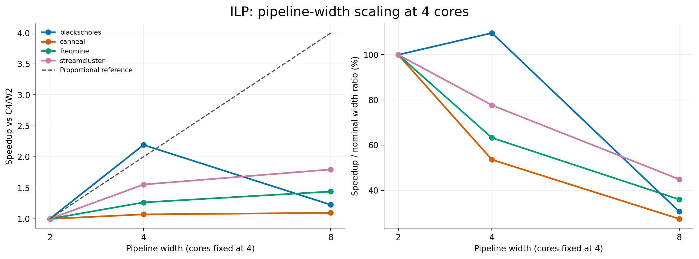

*Warm figure 2. Width-sweep speedup; proportional width scaling is a reference, not a hard ceiling.*

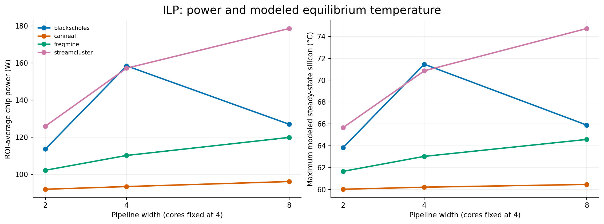

*Warm figure 4. Width-sweep power and equilibrium temperature.*

Blackscholes W4→W8 takes about **78.7% longer**, while average power falls by about **19.9%** and peak temperature falls from **71.46 to 65.89 °C**. This is not an energy win: ROI energy rises from **1.179 to 1.689 J**, about **43.2%**. The active/quiescent counter evidence is discussed below and in the comparison. It would be misleading to call this a physically cheaper eight-wide core; area and reference leakage still increase with width.

For streamcluster W4→W8, power rises from **157.17 to 178.56 W** and peak equilibrium temperature rises **3.87 °C**, while ROI energy decreases slightly, **14.486 to 14.231 J**. The observed width benefit includes a change in executed work and active fraction, so it cannot be interpreted as isolated instruction-level hardware throughput improvement.

## 5. Power breakdown and linearity

At warm C4/W4:

| Workload | Core logic W | L1I+D W | L2 W | NoC W | MC W | Static % |
| --- | --- | --- | --- | --- | --- | --- |
| blackscholes | 64.95 | 64.46 | 7.41 | 20.83 | 0.77 | 48.10 |
| canneal | 36.15 | 26.59 | 7.47 | 22.07 | 1.08 | 81.62 |
| freqmine | 39.88 | 40.48 | 7.45 | 21.45 | 0.88 | 69.19 |
| streamcluster | 56.43 | 69.10 | 7.73 | 23.14 | 0.77 | 48.48 |

Core logic is each detailed McPAT core minus its L1I/D children. Shared L2, whole equivalent NoC and aggregate memory controllers are counted once. This avoids adding parents and children together. Detailed sums conserve processor power within rounding; the largest warm relative discrepancy is **1.85e-06**.

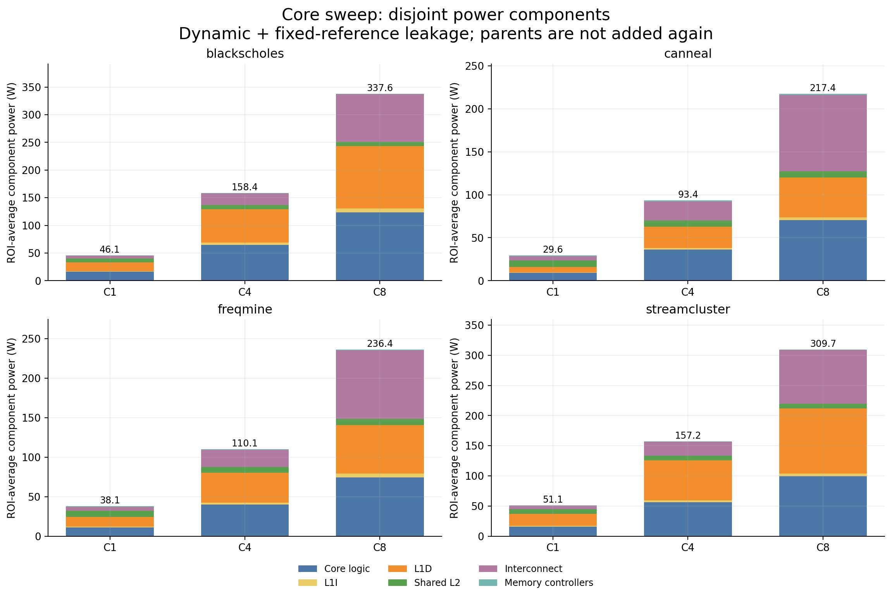

*Warm figure 7. Disjoint component power in the core sweep.*

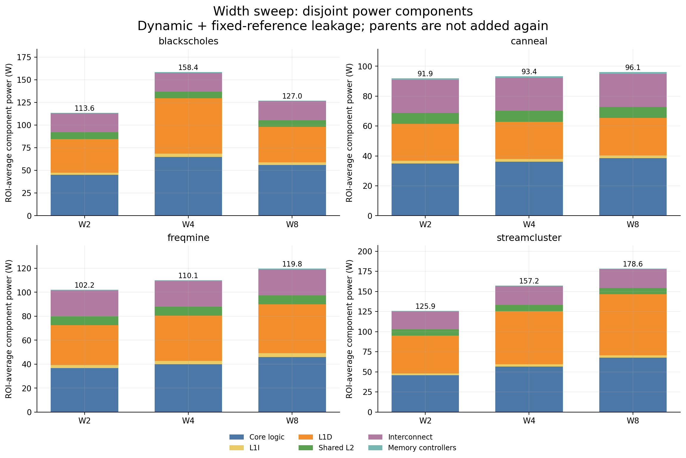

*Warm figure 8. Disjoint component power in the width sweep.*

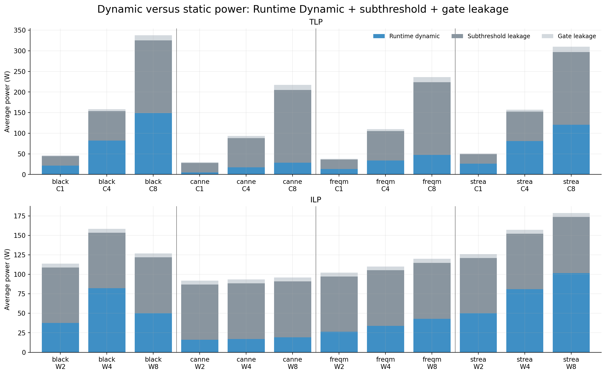

*Warm figure 9. Runtime dynamic, subthreshold and gate leakage contributions.*

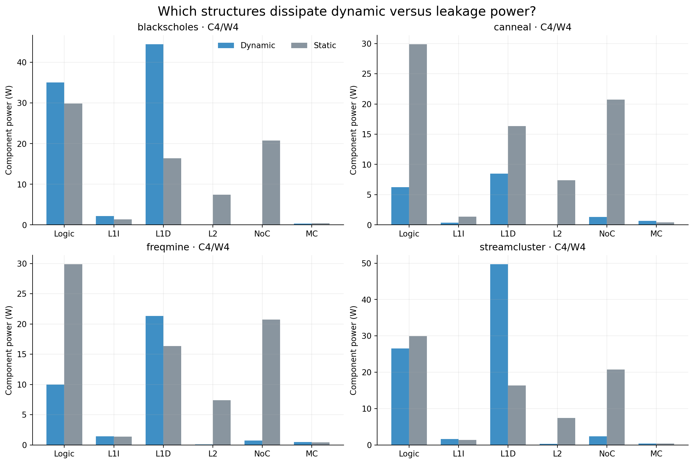

*Warm figure 10. Component-level dynamic versus static watts at C4/W4.*

Reference static power is unchanged by warm-up: approximately **24.74 W at C1/W4**, **76.20 W at C4/W4** and **188.81 W at C8/W4**. The equivalent NoC alone contributes about **5.01, 20.74 and 85.70 W** static. Fully connected SimplePt2Pt endpoints grow with core count, and their physical router/buffer representation is uncalibrated. Large network power slices mostly reflect leakage in this model; they are not measurements of dynamic communication cost alone.

Chip power is below an 8× proportional increase over C1→C8 in all four workloads, but exceeds 2× over C4→C8 for blackscholes, canneal and freqmine. Incremental W/core increases from **37.45→44.80**, **21.27→31.00**, **24.03→31.57** and **35.35→38.13** across the two core intervals. Therefore a single through-origin linear rule does not describe the whole sweep. An affine rule includes fixed overhead; its slope need not be inferred from a total ratio alone.

Width-power growth is small for canneal/freqmine and larger for streamcluster, with a negative W4→W8 slope in the blackscholes anomaly. Runtime average power combines hardware and activity per second. It is not a structural cost curve independent of execution. Three settings and one observation each do not support reliable power-law fitting or extrapolation.

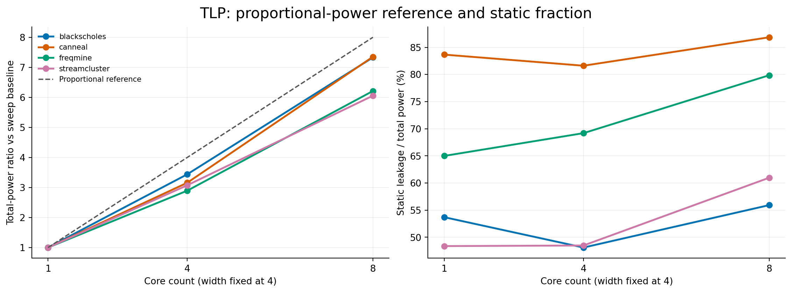

*Warm figure 5. Normalized core power and leakage fraction.*

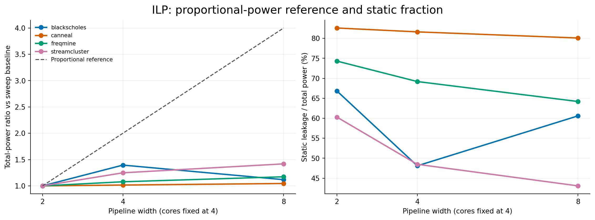

*Warm figure 6. Normalized width power and leakage fraction.*

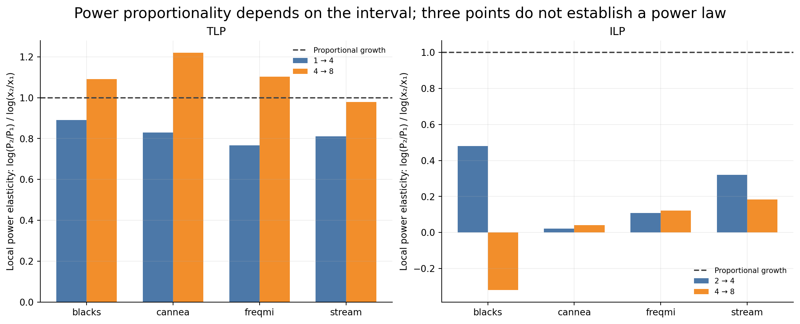

*Warm figure 17. Interval elasticity distinguishes proportional growth from observed activity-dependent changes.*

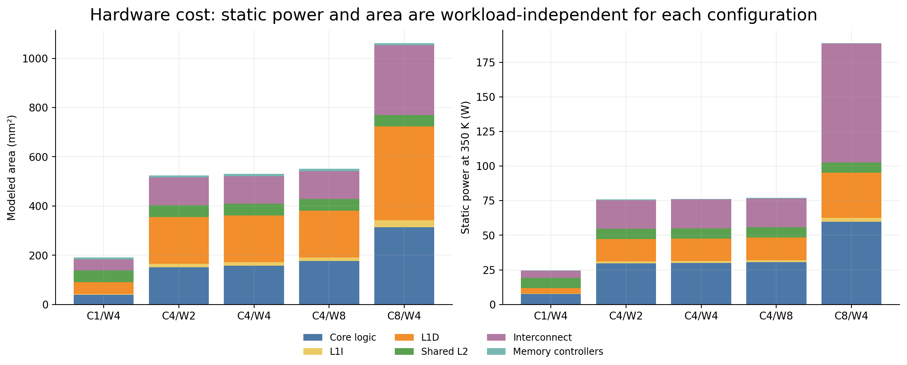

*Warm figure 18. Modeled hardware area and static cost; identical to corresponding cold hardware.*

The cache-area and network approximations remain material: each modeled 32 KiB L1D is about 47.44 mm² versus 3.58 mm² for L1I, and the eight-core die exceeds 1000 mm² in this analytical mapping. These numbers require calibration before physical implementation claims. All 20 warm McPAT runs retain two L2 latency warnings, one per bank; successful conversion does not establish timing closure.

## 6. Executed work and quiescent time

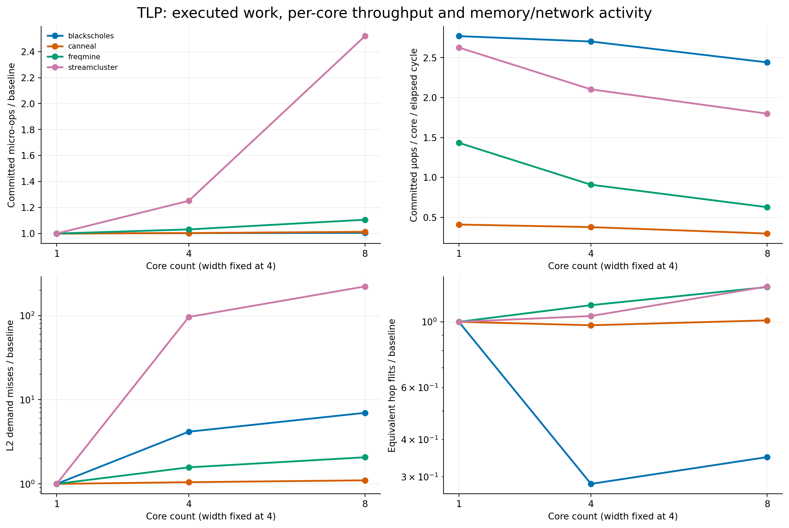

*Warm figure 15. Executed work, wall throughput and memory/network activity across cores.*

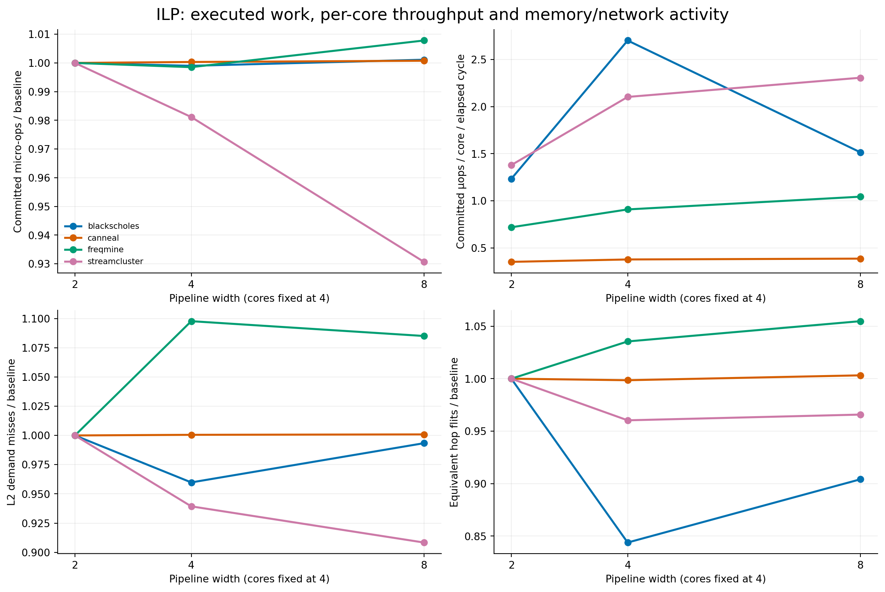

*Warm figure 16. Equivalent diagnostics across pipeline widths.*

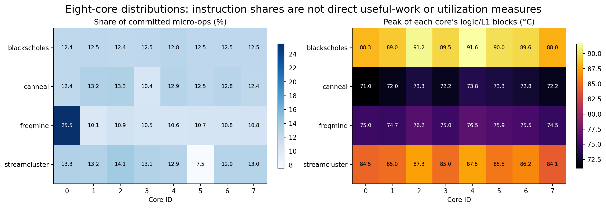

*Warm figure 22. Eight-core retired-work shares and core-block temperatures.*

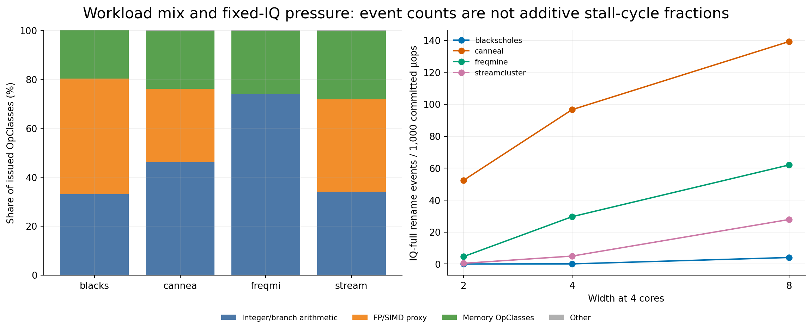

*Warm figure 23. Issued OpClasses and normalized IQ-full events.*

The blackscholes C4/W8 pair is especially informative. Cold/warm committed work differs by only **0.17%**. Wall throughput falls from **3.942 to 1.515 μops/core/cycle**, while active-cycle throughput stays approximately **4.154 versus 4.150**. Recorded active fraction falls from **94.9% to 36.5%**. The quiesce counter normalized to elapsed core-cycles rises from **3.9% to 64.2%**.

gem5 defines `quiesceCycles` for quiesced/wait-for-interrupt time and `idleCycles` for unscheduled idle time; they are not synonymous. These statistics have boundary bookkeeping and should not be summed into an exact 100% partition. They strongly associate this regression with inactive/quiescent time rather than a large deterioration of throughput while active. They do not identify a particular guest scheduler decision, timer, lock or system call. The [comparison](../warm_up_comparison/warm_up_vs_non_warm_up_AI_analysis.md) provides direct paired plots and counter definitions.

Canneal C8 shows a similar active-fraction change with almost unchanged active-cycle throughput. Streamcluster changes its retired work substantially between some cases, consistent with path/synchronization variability. More instructions need not mean more useful application work. No source/PC, runnable-thread or synchronization profile was collected, so exact causes remain hypotheses.

## 7. Energy, EDP and configuration choices

| Sweep | Workload | Fastest | Least ROI energy | Least EDP |
| --- | --- | --- | --- | --- |
| TLP | blackscholes | C8/W4 | C4/W4 | C8/W4 |
| TLP | canneal | C8/W4 | C4/W4 | C8/W4 |
| TLP | freqmine | C8/W4 | C1/W4 | C4/W4 |
| TLP | streamcluster | C4/W4 | C1/W4 | C4/W4 |
| ILP | blackscholes | C4/W4 | C4/W4 | C4/W4 |
| ILP | canneal | C4/W8 | C4/W4 | C4/W8 |
| ILP | freqmine | C4/W8 | C4/W8 | C4/W8 |
| ILP | streamcluster | C4/W8 | C4/W8 | C4/W8 |

These choices are within each sweep and the recorded single observations, with no external area/power/temperature budget. EDP weights time and energy through `E×t`; another objective can choose differently. Canneal's W4/W8 energy difference is small and should not be treated as statistically settled.

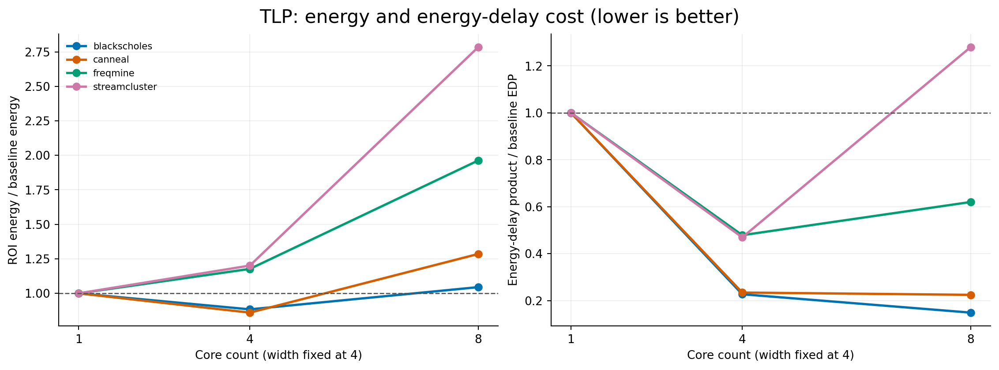

*Warm figure 11. Normalized core-sweep ROI energy and EDP.*

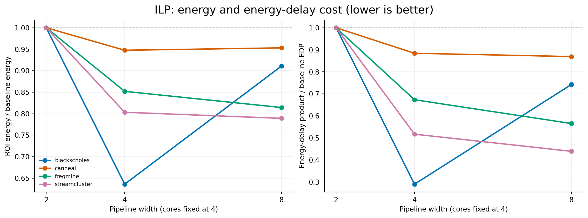

*Warm figure 12. Normalized width-sweep ROI energy and EDP.*

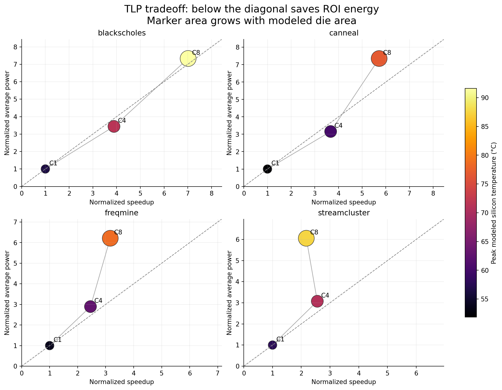

*Warm figure 13. Core-sweep tradeoff; below the diagonal saves ROI energy.*

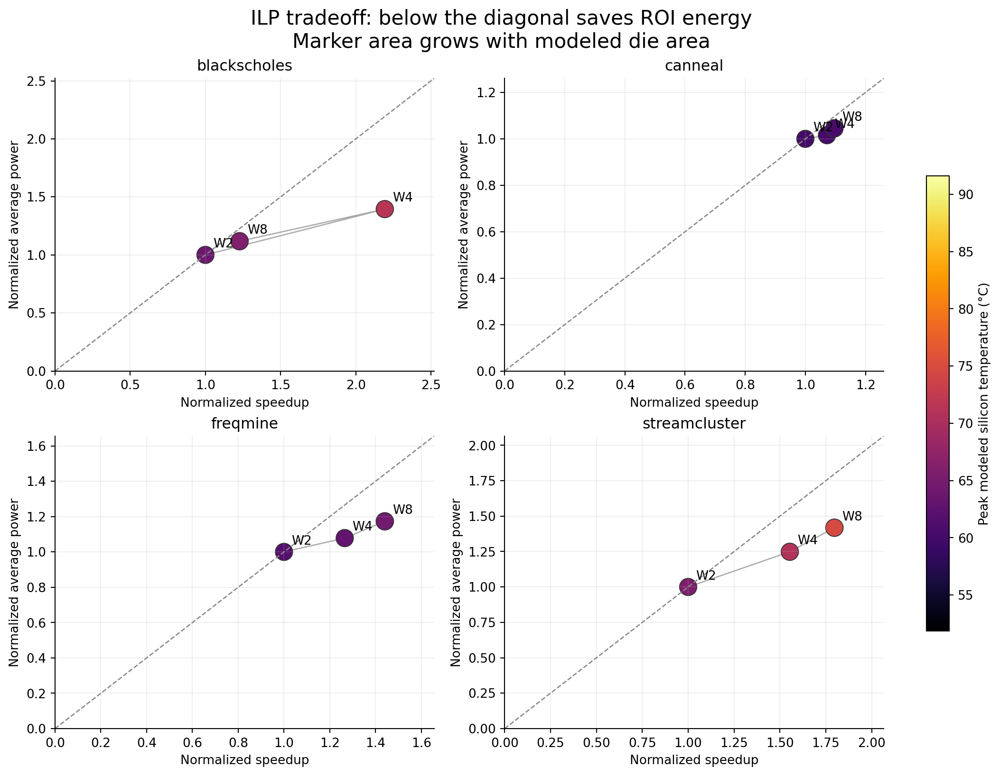

*Warm figure 14. Width-sweep tradeoff; all normalization uses warm baselines.*

Across all five measured settings, blackscholes is fastest/lowest in EDP at C8/W4 and lowest in energy at C4/W4. Canneal is fastest/lowest in EDP at C8/W4 and lowest in energy at C4/W4. Freqmine is fastest at C8/W4, lowest in energy at C1/W4 and lowest in EDP at C4/W8. Streamcluster is fastest/lowest in EDP at C4/W8 and lowest in energy at C1/W4. No unmeasured joint core/width design is declared optimal.

## 8. Thermal meaning

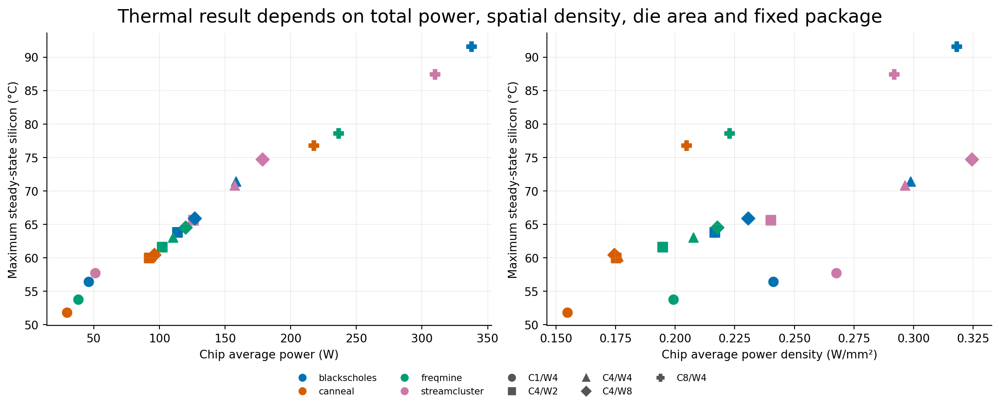

*Warm figure 19. Equilibrium temperature against total power and average die density.*

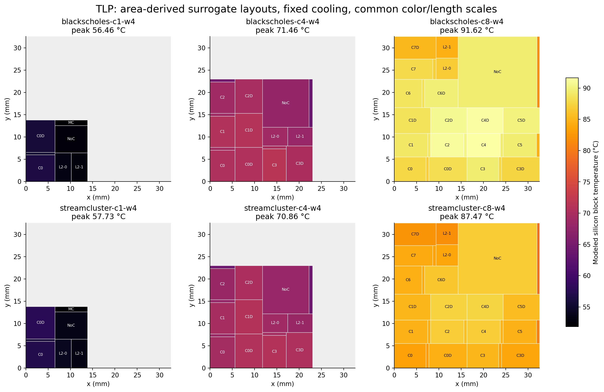

*Warm figure 20. Core-sweep surrogate thermal maps under common cooling and color/length scales.*

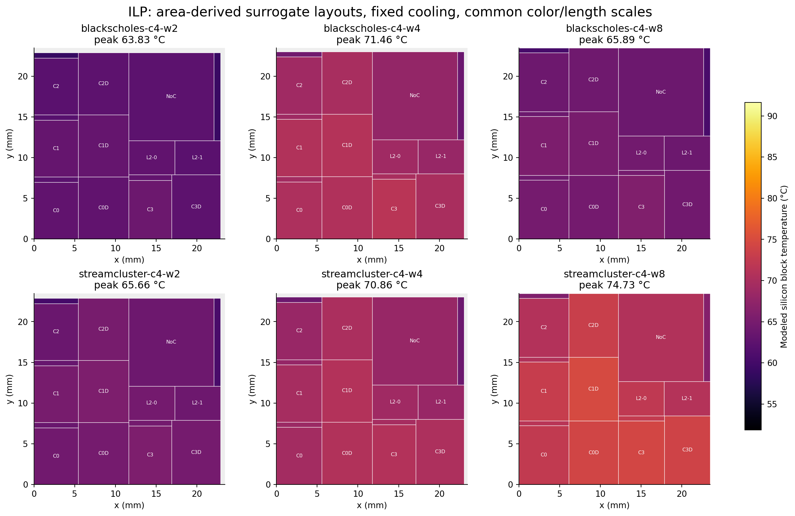

*Warm figure 21. Width-sweep surrogate thermal maps; blackscholes W8 is cooler because of its lower average ROI power.*

The maximum is **91.62 °C at blackscholes C8/W4**. Core-sweep temperatures increase with cores, but the blackscholes width sweep is nonmonotonic. More width can produce a cooler yet slower, more energy-consuming run when activity per second falls and fixed leakage persists.

HotSpot uses 45 °C ambient, an area-derived square die with no whitespace, coarse uniform-power blocks, a 50 mm spreader/70 mm sink and fixed cooling. These are equilibrium predictions for average ROI power applied indefinitely. Detailed CPU/cache warm-up does not mean the silicon was thermally preheated in this model: pre-ROI temperature history is not an input. Temperature/leakage feedback and fine within-block hotspots remain unmodeled.

## 9. Warm-up coverage and reliability

Excluded initialization spans **0.332–1.411 simulated seconds**, or **0.56–101.91×** each measured ROI duration. Its contents include the guest launcher and application setup, not solely useful application operations. Nonzero pre-ROI cache activity and committed instructions prove detailed execution occurred, not that ROI working sets/predictors converged. A longer warm-up is not automatically a better representative warm-up.

| Case | Excluded init s | Init / ROI time | Init architectural instructions | Init L1D demands |
| --- | --- | --- | --- | --- |
| blackscholes-c1-w4 | 0.353 | 12.200 | 861080585 | 389513827 |
| blackscholes-c4-w2 | 0.514 | 31.468 | 872736989 | 400145047 |
| blackscholes-c4-w4 | 0.425 | 57.054 | 873940987 | 392565018 |
| blackscholes-c4-w8 | 0.379 | 28.459 | 874687445 | 376816041 |
| blackscholes-c8-w4 | 0.421 | 101.915 | 875202902 | 393892733 |
| canneal-c1-w4 | 1.095 | 3.072 | 2144680938 | 881805922 |
| canneal-c4-w2 | 1.411 | 13.545 | 2161341310 | 889286076 |
| canneal-c4-w4 | 1.170 | 12.044 | 2161006544 | 886033733 |
| canneal-c4-w8 | 1.092 | 11.503 | 2172960651 | 873057244 |
| canneal-c8-w4 | 1.186 | 19.018 | 2168121455 | 890656782 |
| freqmine-c1-w4 | 0.369 | 0.560 | 859361383 | 394141964 |
| freqmine-c4-w2 | 0.550 | 1.622 | 871533805 | 404850562 |
| freqmine-c4-w4 | 0.446 | 1.665 | 870974272 | 396909185 |
| freqmine-c4-w8 | 0.408 | 1.733 | 871794932 | 381644238 |
| freqmine-c8-w4 | 0.455 | 2.185 | 873676273 | 398601036 |
| streamcluster-c1-w4 | 0.332 | 1.409 | 818073812 | 373904262 |
| streamcluster-c4-w2 | 0.502 | 3.503 | 830261253 | 385130527 |
| streamcluster-c4-w4 | 0.402 | 4.359 | 831471828 | 377438573 |
| streamcluster-c4-w8 | 0.370 | 4.641 | 831743503 | 362050669 |
| streamcluster-c8-w4 | 0.411 | 3.792 | 831691075 | 378516048 |

The [validation record](data/validation.json) covers 20 cases, 24 sweep rows and **300 hashed source artifacts**, including separate warm-up metadata/snapshots. The [mapping policies](../../configs/README.md) and [source manifests](data/input_sha256.json) allow auditing. Three warm cases have documented cycle bookkeeping notes; exact tick duration is always used. Zero-valued quiesce/idle-event counters may be absent because the pinned gem5 source declares `.prereq(stat)`; only these explicitly zero-suppressed counters are mapped to zero, not arbitrary missing activity.

Warm-up interpretation must account for scheduling/history changes, single observations, incomplete physical activity mappings, L2 timing warnings, fixed leakage and surrogate geometry/cooling. Preserve this full-ROI definition when repeating experiments. Priority repeats are blackscholes widths 4/8, canneal C8, and streamcluster widths 2/8, with both scenarios and effective thread-placement/idle/synchronization evidence. If identical restores reproduce exactly, copies of that deterministic result are not independent random trials; document controlled sensitivity conditions before assigning variability or confidence intervals. No new simulation was launched for this analysis.

## 10. Reproduction and files

From the repository root, with dependencies installed and both raw datasets plus matching binaries available:

```bash
.venv-analysis/bin/python scripts/analyze_warm_up.py
```

This writes `reports/warm_up/` and `reports/warm_up_comparison/`, preserving the original non-warm-up report/assets and all raw results. `--extract-only` validates/extracts data without figures. `--reuse-extracted` rechecks source hashes and the shared extractor identity before reusing tables; matched calculations and report generation still run again. The [comparison validation](../warm_up_comparison/data/validation.json) records the analysis/extractor/model hashes and upstream commits. The interactive [warm tradeoff plot](interactive_tradeoffs.html) opens offline.

Warm tables use the same schema as the [reference data guide](../README.md), with added pre-ROI fields, recorded active-cycle throughput and quiesce diagnostics. The complete case values follow; source values retain more digits than these rounded displays.

| Case | ROI ms | Dynamic W | Static W | Total W | ROI J | Peak °C | Excluded init s |
| --- | --- | --- | --- | --- | --- | --- | --- |
| blackscholes-c1-w4 | 28.949 | 21.328 | 24.737 | 46.065 | 1.334 | 56.46 | 0.353 |
| blackscholes-c4-w2 | 16.321 | 37.664 | 75.911 | 113.575 | 1.854 | 63.83 | 0.514 |
| blackscholes-c4-w4 | 7.442 | 82.212 | 76.203 | 158.415 | 1.179 | 71.46 | 0.425 |
| blackscholes-c4-w8 | 13.300 | 50.022 | 76.934 | 126.956 | 1.689 | 65.89 | 0.379 |
| blackscholes-c8-w4 | 4.128 | 148.816 | 188.812 | 337.628 | 1.394 | 91.62 | 0.421 |
| canneal-c1-w4 | 356.550 | 4.830 | 24.737 | 29.567 | 10.542 | 51.85 | 1.095 |
| canneal-c4-w2 | 104.139 | 16.005 | 75.911 | 91.916 | 9.572 | 60.02 | 1.411 |
| canneal-c4-w4 | 97.155 | 17.161 | 76.203 | 93.364 | 9.071 | 60.21 | 1.170 |
| canneal-c4-w8 | 94.969 | 19.136 | 76.934 | 96.070 | 9.124 | 60.46 | 1.092 |
| canneal-c8-w4 | 62.344 | 28.567 | 188.812 | 217.379 | 13.552 | 76.83 | 1.186 |
| freqmine-c1-w4 | 659.281 | 13.322 | 24.737 | 38.059 | 25.092 | 53.79 | 0.369 |
| freqmine-c4-w2 | 339.380 | 26.245 | 75.911 | 102.156 | 34.670 | 61.66 | 0.550 |
| freqmine-c4-w4 | 268.206 | 33.932 | 76.203 | 110.135 | 29.539 | 63.03 | 0.446 |
| freqmine-c4-w8 | 235.602 | 42.906 | 76.934 | 119.840 | 28.234 | 64.58 | 0.408 |
| freqmine-c8-w4 | 208.321 | 47.617 | 188.812 | 236.429 | 49.253 | 78.66 | 0.455 |
| streamcluster-c1-w4 | 235.784 | 26.401 | 24.737 | 51.138 | 12.058 | 57.73 | 0.332 |
| streamcluster-c4-w2 | 143.220 | 49.991 | 75.911 | 125.902 | 18.032 | 65.66 | 0.502 |
| streamcluster-c4-w4 | 92.163 | 80.970 | 76.203 | 157.173 | 14.486 | 70.86 | 0.402 |
| streamcluster-c4-w8 | 79.702 | 101.622 | 76.934 | 178.556 | 14.231 | 74.73 | 0.370 |
| streamcluster-c8-w4 | 108.410 | 120.865 | 188.812 | 309.677 | 33.572 | 87.47 | 0.411 |

### Figure downloads

| Figure | Raster | Vector | Document |
| --- | --- | --- | --- |
| 01_tlp_speedup | [PNG](figures/01_tlp_speedup.png) | [SVG](figures/01_tlp_speedup.svg) | [PDF](figures/01_tlp_speedup.pdf) |
| 02_ilp_speedup | [PNG](figures/02_ilp_speedup.png) | [SVG](figures/02_ilp_speedup.svg) | [PDF](figures/02_ilp_speedup.pdf) |
| 03_tlp_power_temperature | [PNG](figures/03_tlp_power_temperature.png) | [SVG](figures/03_tlp_power_temperature.svg) | [PDF](figures/03_tlp_power_temperature.pdf) |
| 04_ilp_power_temperature | [PNG](figures/04_ilp_power_temperature.png) | [SVG](figures/04_ilp_power_temperature.svg) | [PDF](figures/04_ilp_power_temperature.pdf) |
| 05_tlp_normalized_power | [PNG](figures/05_tlp_normalized_power.png) | [SVG](figures/05_tlp_normalized_power.svg) | [PDF](figures/05_tlp_normalized_power.pdf) |
| 06_ilp_normalized_power | [PNG](figures/06_ilp_normalized_power.png) | [SVG](figures/06_ilp_normalized_power.svg) | [PDF](figures/06_ilp_normalized_power.pdf) |
| 07_tlp_component_power | [PNG](figures/07_tlp_component_power.png) | [SVG](figures/07_tlp_component_power.svg) | [PDF](figures/07_tlp_component_power.pdf) |
| 08_ilp_component_power | [PNG](figures/08_ilp_component_power.png) | [SVG](figures/08_ilp_component_power.svg) | [PDF](figures/08_ilp_component_power.pdf) |
| 09_dynamic_static_power | [PNG](figures/09_dynamic_static_power.png) | [SVG](figures/09_dynamic_static_power.svg) | [PDF](figures/09_dynamic_static_power.pdf) |
| 10_component_dynamic_static | [PNG](figures/10_component_dynamic_static.png) | [SVG](figures/10_component_dynamic_static.svg) | [PDF](figures/10_component_dynamic_static.pdf) |
| 11_tlp_energy_edp | [PNG](figures/11_tlp_energy_edp.png) | [SVG](figures/11_tlp_energy_edp.svg) | [PDF](figures/11_tlp_energy_edp.pdf) |
| 12_ilp_energy_edp | [PNG](figures/12_ilp_energy_edp.png) | [SVG](figures/12_ilp_energy_edp.svg) | [PDF](figures/12_ilp_energy_edp.pdf) |
| 13_tlp_tradeoff | [PNG](figures/13_tlp_tradeoff.png) | [SVG](figures/13_tlp_tradeoff.svg) | [PDF](figures/13_tlp_tradeoff.pdf) |
| 14_ilp_tradeoff | [PNG](figures/14_ilp_tradeoff.png) | [SVG](figures/14_ilp_tradeoff.svg) | [PDF](figures/14_ilp_tradeoff.pdf) |
| 15_tlp_work_diagnostics | [PNG](figures/15_tlp_work_diagnostics.png) | [SVG](figures/15_tlp_work_diagnostics.svg) | [PDF](figures/15_tlp_work_diagnostics.pdf) |
| 16_ilp_work_diagnostics | [PNG](figures/16_ilp_work_diagnostics.png) | [SVG](figures/16_ilp_work_diagnostics.svg) | [PDF](figures/16_ilp_work_diagnostics.pdf) |
| 17_power_elasticity | [PNG](figures/17_power_elasticity.png) | [SVG](figures/17_power_elasticity.svg) | [PDF](figures/17_power_elasticity.pdf) |
| 18_area_and_static_cost | [PNG](figures/18_area_and_static_cost.png) | [SVG](figures/18_area_and_static_cost.svg) | [PDF](figures/18_area_and_static_cost.pdf) |
| 19_temperature_power_density | [PNG](figures/19_temperature_power_density.png) | [SVG](figures/19_temperature_power_density.svg) | [PDF](figures/19_temperature_power_density.pdf) |
| 20_tlp_thermal_floorplans | [PNG](figures/20_tlp_thermal_floorplans.png) | [SVG](figures/20_tlp_thermal_floorplans.svg) | [PDF](figures/20_tlp_thermal_floorplans.pdf) |
| 21_ilp_thermal_floorplans | [PNG](figures/21_ilp_thermal_floorplans.png) | [SVG](figures/21_ilp_thermal_floorplans.svg) | [PDF](figures/21_ilp_thermal_floorplans.pdf) |
| 22_per_core_work_and_temperature | [PNG](figures/22_per_core_work_and_temperature.png) | [SVG](figures/22_per_core_work_and_temperature.svg) | [PDF](figures/22_per_core_work_and_temperature.pdf) |
| 23_mix_and_iq_pressure | [PNG](figures/23_mix_and_iq_pressure.png) | [SVG](figures/23_mix_and_iq_pressure.svg) | [PDF](figures/23_mix_and_iq_pressure.pdf) |
