# Warm-up versus non-warm-up AI analysis

This report compares **20 matched full-ROI cases per scenario**: PARSEC 3.0 `simsmall` blackscholes, canneal, freqmine and streamcluster, using five hardware configurations. Both gem5→McPAT→HotSpot datasets passed validation. The original [cold report](../non_warm_up/non_warm_up_AI_analysis.md) is preserved; the [warm report](../warm_up/warm_up_AI_analysis.md) analyzes the new scenario independently.

**Main finding:** pre-ROI O3 initialization does not produce a uniform improvement. **12/20** warm runs are faster, but **8/20** time changes are within ±1%, and there is only one observation per pair. Blackscholes C4/W8 is **2.606× as slow**, with **62.4% more energy**, despite lower modeled watts and temperature. Streamcluster C4/W8 is **19.5% faster** and changes the preferred measured width from four to eight. Core-scaling conclusions mostly persist, with a material canneal C8 regression. The counter evidence points to substantial changes in inactive/quiescent time and, for streamcluster, executed work; cache-miss reductions alone do not explain the outcomes.

Open the [interactive comparison](interactive_comparison.html) in a browser for all paired effects. Positive time/energy percentage changes mean higher cost; negative changes mean reductions. Temperature uses absolute °C differences.

## 1. What is comparable, and what is not controlled

| Property | Non-warm-up | Pre-ROI warm-up |
| --- | --- | --- |
| Fast-forward/checkpoint boundary | `WORKBEGIN`, before O3 switch | Earlier PARSEC launch marker, before O3 initialization |
| Detailed CPU initialization | Begins at ROI entry | Runs through launcher/application initialization before ROI |
| Measured work | Full `WORKBEGIN`→`WORKEND` | Same full `WORKBEGIN`→`WORKEND` |
| Statistics reset | After O3 switch at entry | At entry with warmed O3/cache state retained |
| Hardware/workloads/physical models | Frozen v1 | Matching fields checked against v1 |
| Observations | One per case | One per case |

The [resolved hardware checks](data/hardware_checks.csv) show identical O3 cores, cache hierarchies, memory configuration, clocks, area, reference static power, floorplan files and thermal configs for all 20 pairs. Both use the same upstream revisions and model files. This makes matched physical-cost calculations consistent, but does not establish physical model accuracy.

Pre-ROI execution history is different. Guest scheduling, interrupt/wakeup phase, thread state and application execution paths may also differ at ROI entry. The warm-up is workload-dependent initialization, not a fixed instruction budget or demonstrated converged ROI state. This experiment compares **two execution methodologies**; it does not isolate cache contents as the only independent variable. A single paired observation cannot separate repeat variability from a repeatable methodological effect.

## 2. Paired metrics and complete results

For each identical workload/configuration, define `Rₜ=t_warm/t_cold`, `Rₚ=P_warm/P_cold`, `Rₑ=E_warm/E_cold=RₜRₚ` and `R_EDP=RₚRₜ²`. Paired speedup is `1/Rₜ`. Report percentage changes as `100(R−1)`. These paired ratios differ from the within-sweep speedups discussed next. Both scenarios exclude pre-ROI time/energy from ROI metrics; an end-to-end application energy comparison was not measured.

| Case | Cold ms | Warm ms | Time Δ% | Power Δ% | Energy Δ% | Temperature Δ°C |
| --- | --- | --- | --- | --- | --- | --- |
| blackscholes-c1-w4 | 29.094 | 28.949 | -0.50 | 0.21 | -0.28 | 0.03 |
| blackscholes-c4-w2 | 16.397 | 16.321 | -0.46 | 0.13 | -0.33 | 0.02 |
| blackscholes-c4-w4 | 8.380 | 7.442 | -11.20 | 5.95 | -5.91 | 1.54 |
| blackscholes-c4-w8 | 5.104 | 13.300 | 160.56 | -37.69 | 62.36 | -13.13 |
| blackscholes-c8-w4 | 4.200 | 4.128 | -1.72 | 0.73 | -1.00 | 0.43 |
| canneal-c1-w4 | 356.355 | 356.550 | 0.05 | -0.01 | 0.05 | 0.00 |
| canneal-c4-w2 | 106.387 | 104.139 | -2.11 | 0.28 | -1.84 | 0.05 |
| canneal-c4-w4 | 99.459 | 97.155 | -2.32 | 0.33 | -1.99 | 0.05 |
| canneal-c4-w8 | 97.103 | 94.969 | -2.20 | 0.40 | -1.80 | 0.07 |
| canneal-c8-w4 | 53.126 | 62.344 | 17.35 | -1.89 | 15.13 | -0.50 |
| freqmine-c1-w4 | 659.217 | 659.281 | 0.01 | 0.00 | 0.01 | 0.00 |
| freqmine-c4-w2 | 341.468 | 339.380 | -0.61 | 0.17 | -0.44 | 0.02 |
| freqmine-c4-w4 | 267.772 | 268.206 | 0.16 | -0.07 | 0.09 | 0.05 |
| freqmine-c4-w8 | 233.350 | 235.602 | 0.96 | -0.01 | 0.95 | 0.04 |
| freqmine-c8-w4 | 211.514 | 208.321 | -1.51 | 0.27 | -1.25 | 0.06 |
| streamcluster-c1-w4 | 235.913 | 235.784 | -0.05 | 0.03 | -0.03 | 0.00 |
| streamcluster-c4-w2 | 116.151 | 143.220 | 23.31 | -4.18 | 18.15 | -0.97 |
| streamcluster-c4-w4 | 87.719 | 92.163 | 5.07 | -1.89 | 3.08 | -0.58 |
| streamcluster-c4-w8 | 98.987 | 79.702 | -19.48 | 6.01 | -14.64 | 1.96 |
| streamcluster-c8-w4 | 121.859 | 108.410 | -11.04 | 1.30 | -9.88 | 0.39 |

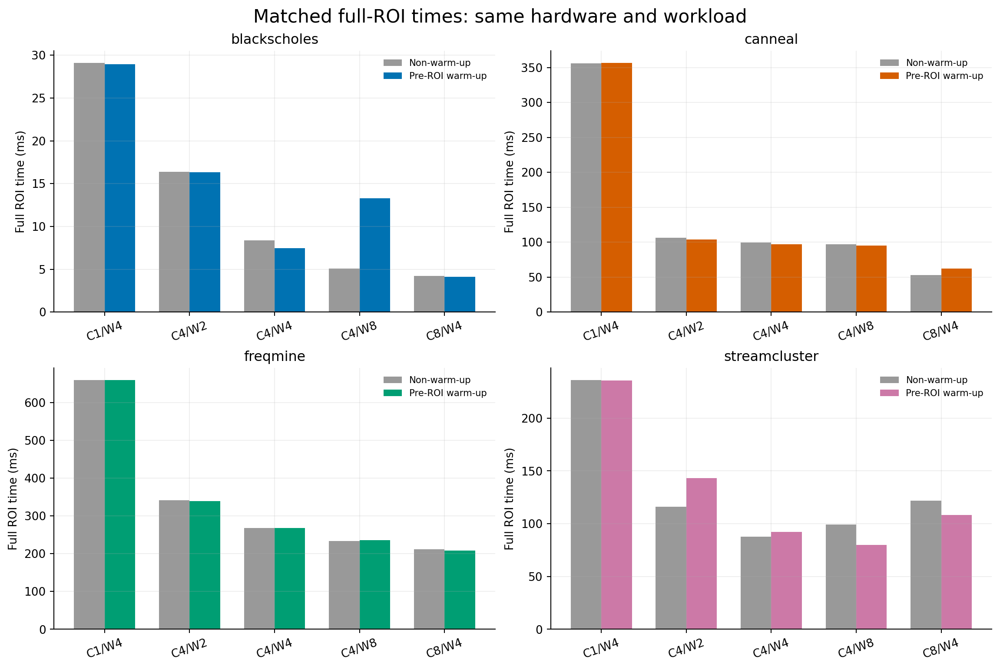

*Comparison figure 1. Full-ROI times for the same workload/hardware; per-workload axes differ.*

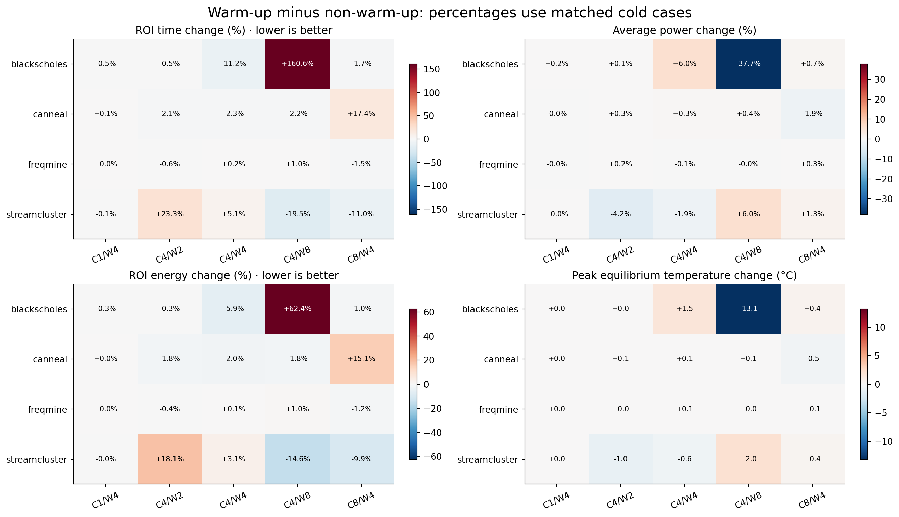

*Comparison figure 2. Matched time, average power, energy and temperature effects.*

Across all 20 equally weighted pairs, geometric-mean ratios are **1.042× time**, **0.980× power**, **1.021× energy**, and **1.064× EDP**. This is approximately +4.2% time, −2.0% watts, +2.1% energy and +6.4% EDP. These descriptive means do not represent an actual job mixture or uncertainty interval. They are sensitive to the blackscholes W8 observation: the other 19 cases' time-ratio geometric mean is **0.993×**. That sensitivity is a reason to show all cases, not to discard the outlier.

## 3. Do the scaling conclusions change?

| Sweep | Workload | Cold S₄ | Warm S₄ | Cold S₈ | Warm S₈ |
| --- | --- | --- | --- | --- | --- |
| TLP | blackscholes | 3.472 | 3.890 | 6.928 | 7.014 |
| TLP | canneal | 3.583 | 3.670 | 6.708 | 5.719 |
| TLP | freqmine | 2.462 | 2.458 | 3.117 | 3.165 |
| TLP | streamcluster | 2.689 | 2.558 | 1.936 | 2.175 |
| ILP | blackscholes | 1.957 | 2.193 | 3.212 | 1.227 |
| ILP | canneal | 1.070 | 1.072 | 1.096 | 1.097 |
| ILP | freqmine | 1.275 | 1.265 | 1.463 | 1.440 |
| ILP | streamcluster | 1.324 | 1.554 | 1.173 | 1.797 |

Each scenario is normalized to **its own C1/W4** for core scaling and **its own C4/W2** for width scaling. A sweep speedup cannot be compared as if its denominator were unchanged. The same C4/W4 measurement appears in both sweeps; there are 24 paired sweep rows, not 24 independent cases.

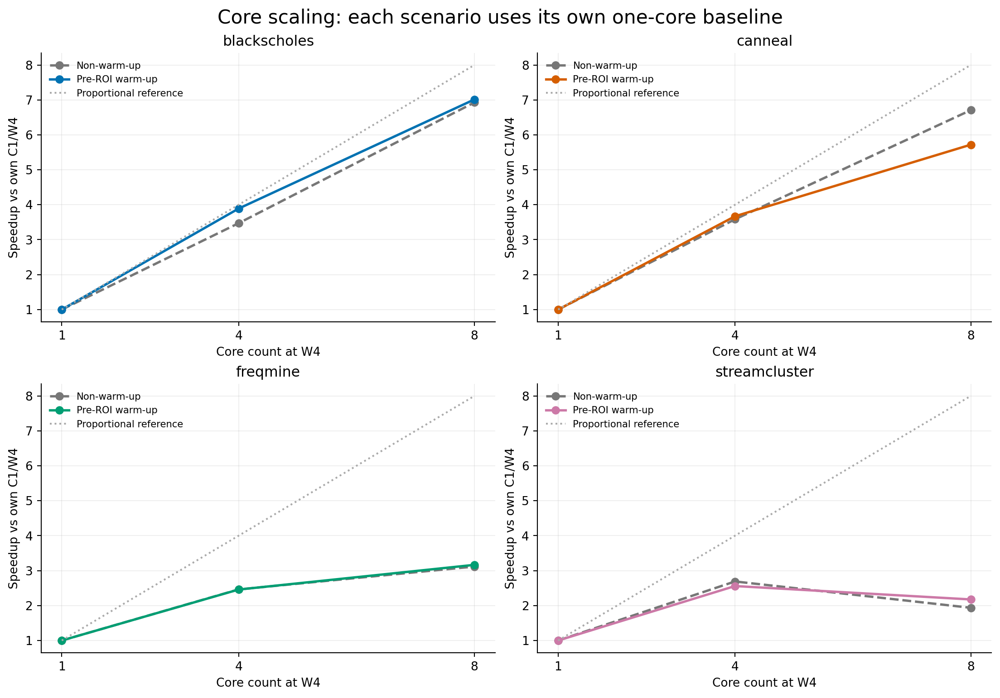

*Comparison figure 3. Core-count speedups with separate cold/warm one-core baselines.*

**TLP:** blackscholes remains strong, reaching **7.014× warm versus 6.928× cold** at C8. Canneal falls from **6.708× to 5.719×**, although four-core scaling improves slightly. Freqmine stays around **3.12–3.16×** at C8. Streamcluster improves C8 speedup from **1.936× to 2.175×**, but C4 remains faster within its W4 core sweep. Warm-up therefore does not remove its multicore scaling limitation.

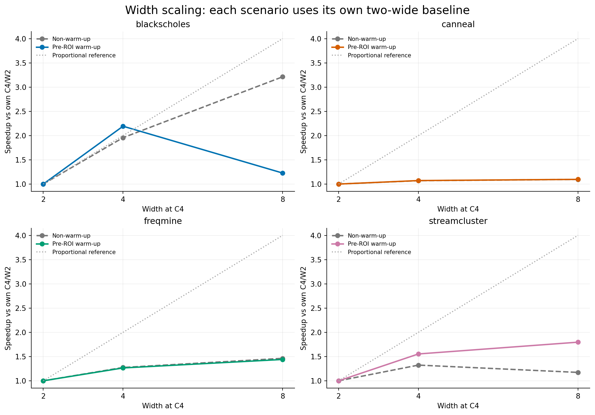

*Comparison figure 4. Width speedups with separate cold/warm two-wide baselines.*

**ILP:** blackscholes changes sharply: width-eight speedup falls from **3.212× to 1.227×**; warm W4 is fastest. Canneal remains near **1.096×** at W8 and freqmine near **1.44–1.46×**. Streamcluster W8 speedup improves from **1.173× to 1.797×**. Its warm W8 time improves 19.5%, while its warm W2 baseline is 23.3% slower; both endpoints contribute to the much larger normalized speedup. For blackscholes, W2 changes by less than 1%, so the width-eight speedup collapse primarily reflects the target case's regression.

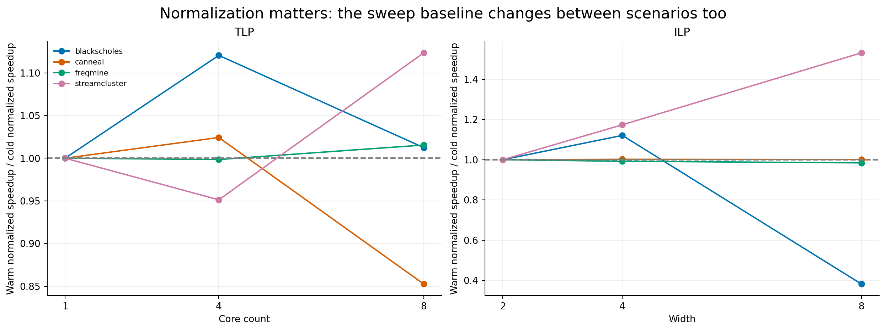

*Comparison figure 15. Ratio of warm/cold normalized speedups; both target and baseline contribute.*

The observed blackscholes W2→W4 warm speedup exceeds the nominal width ratio. This is a wall-time outcome that includes activity/scheduling differences, not proof of a universal throughput law. Width changes all seven pipeline widths while fixed queue/FU resources constrain available execution capacity.

## 4. Blackscholes C4/W8: slower, cooler, and more energy-consuming

Warm full ROI time is **13.300 ms versus 5.104 ms**. Architectural inputs, resolved core configuration and modeled area/leakage match. Committed μops differ by only **0.17%**. L2 demand misses fall by about **52.7%**, so a claim that additional L2 misses caused the regression is inconsistent with these counters.

| Case | Cold active % | Warm active % | Cold active μIPC | Warm active μIPC | Cold quiesce/elapsed % | Warm quiesce/elapsed % |
| --- | --- | --- | --- | --- | --- | --- |
| blackscholes-c4-w8 | 94.906 | 36.517 | 4.154 | 4.150 | 3.861 | 64.189 |
| canneal-c8-w4 | 95.966 | 82.028 | 0.362 | 0.362 | 3.406 | 17.872 |

Recorded active-cycle throughput is nearly unchanged, while wall throughput falls approximately **61.6%**. Active fraction falls from about **94.9% to 36.5%**. Quiesce cycles normalized to elapsed core-cycles rise from about **3.9% to 64.2%**. The [pinned gem5 CPU source](https://github.com/gem5/gem5/blob/e97d8fbfbe4ff549b2c90183956f719ada856756/src/cpu/o3/cpu.cc) defines quiesce cycles for waiting/quiesced intervals, separately from idle cycles used when the CPU unschedules for idling.

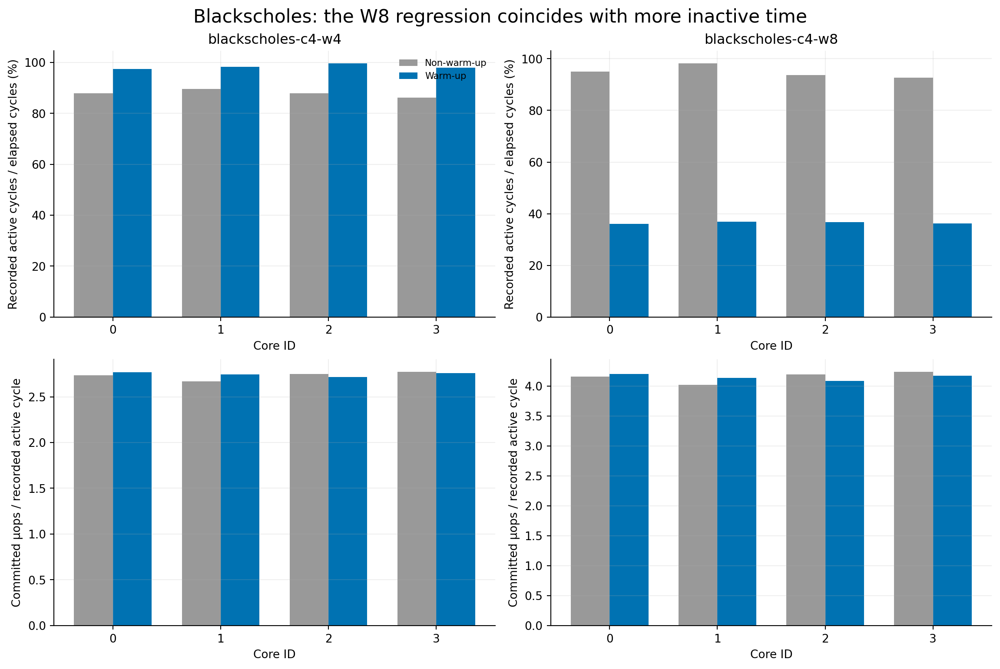

*Comparison figure 13. Per-core active fraction and active-cycle throughput for blackscholes widths 4/8.*

This supports an association with inactive/quiescent periods rather than a large loss of throughput during active cycles. A guest scheduler/wakeup/synchronization explanation is plausible, but the exact cause is not established: no PC/source trace, runnable-thread profile or lock timing was collected. Counter bookkeeping at boundaries also means active/idle/quiesce ratios must not be added into an exact 100% partition.

Average power falls from **203.74 to 126.96 W**, while energy rises from **1.040 to 1.689 J**. Lower activity per second reduces runtime dynamic watts; fixed leakage keeps accumulating over the longer ROI. Of the **0.649 J** energy increase, about **0.631 J (97.2%)** comes from additional fixed-reference static energy. This accounting is conditional on no power gating and fixed leakage temperature.

| Component | Cold dynamic W | Warm dynamic W | Fixed static W | Total ΔW |
| --- | --- | --- | --- | --- |
| core_logic | 63.722 | 25.525 | 30.601 | -38.197 |
| l1i | 3.304 | 1.273 | 1.387 | -2.031 |
| l1d | 59.273 | 22.811 | 16.362 | -36.462 |
| l2 | 0.013 | 0.006 | 7.401 | -0.006 |
| interconnect | 0.130 | 0.054 | 20.771 | -0.076 |
| memory_controller | 0.364 | 0.353 | 0.411 | -0.012 |

Peak modeled equilibrium temperature decreases by **13.13 °C**, despite increased execution energy. Cooling responds to sustained watts/distribution in this steady-state calculation, whereas energy integrates watts over the finite ROI. Cooler does not imply more efficient completion.

## 5. Other paired effects and diagnostic limits

**Canneal C8/W4:** full ROI time increases **17.4%**, while committed work grows only **0.23%**. Active-cycle throughput remains approximately 0.362 μops/cycle; active fraction decreases from about 96.0% to 82.0%, with much more recorded quiescent time. Average power falls slightly, but energy increases **15.1%**. The TLP result remains useful but less efficient than the cold observation. This is another priority for repeat measurements and scheduler/wakeup evidence.

**Streamcluster C4/W8:** time decreases **19.5%**, energy decreases **14.6%**, and committed μops decrease **14.9%**. Wall throughput improves about 5.7%; active-cycle throughput is nearly unchanged. The improvement therefore includes less executed work and a higher active fraction. It is not a clean observation of a larger amount of useful work per instruction window.

**Streamcluster C4/W2:** time increases 23.3% and committed work increases about 15.2%; C4/W4 also becomes about 5.1% slower. These changes explain why wider-pipeline normalization changes substantially. C8/W4 becomes about 11.0% faster with about 9.9% fewer committed μops, but still loses to C4/W4 within the core sweep.

**Freqmine and one-core cases:** many changes are small. All one-core ROI changes are below 0.5% in magnitude, and most freqmine changes are near 1% or less except C8's roughly 1.5% improvement. Small single-observation deltas should not be advertised as statistically established gains.

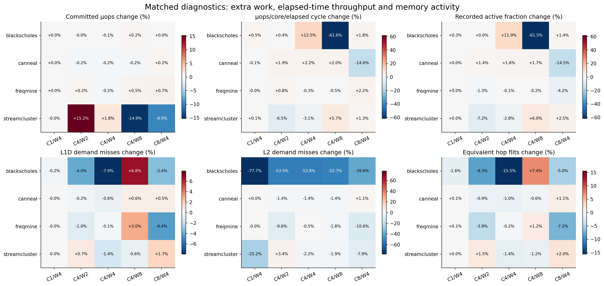

*Comparison figure 8. Work, throughput, active fraction, cache-miss and network-activity changes.*

For identical `N` and clock, the exact accounting identity is `t = U/(N f a IPC_active)`, where `U` is retired μops and `a` the recorded active fraction. Thus `Rₜ = R_U/(R_a R_IPC_active)`. This decomposes the measured totals; it is not a causal model of useful work. More retired instructions may reflect synchronization, runtime/OS work or execution-path variation.

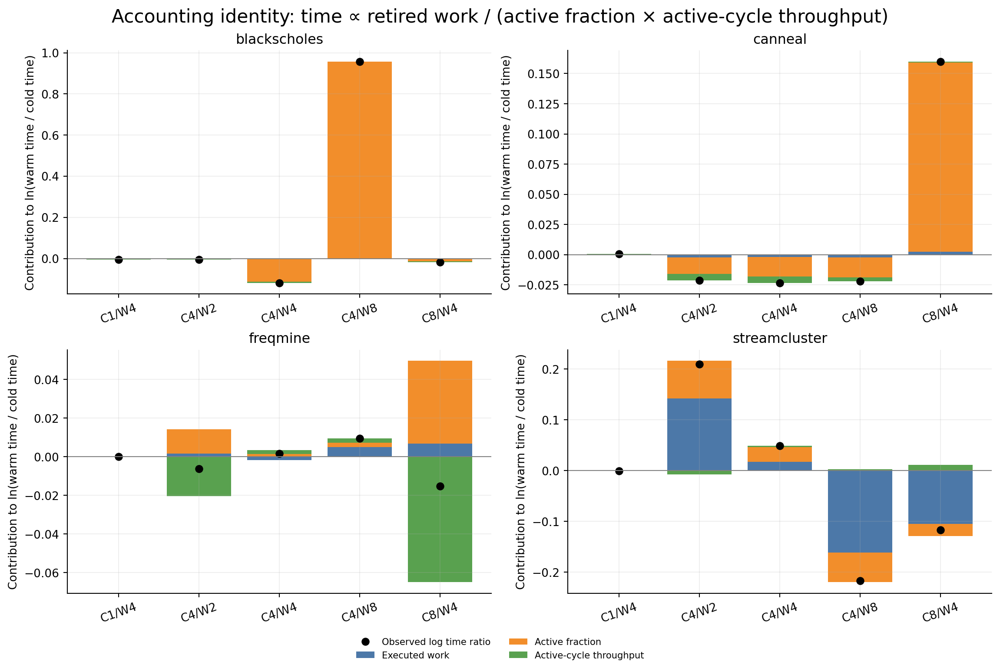

*Comparison figure 14. Log-ratio accounting of work, active fraction and active-cycle throughput; dots are the observed time ratio.*

L2 demand misses are not DRAM requests, and network hop flits are not stall cycles or injected packet counts. Changes in those counters support follow-up hypotheses but do not prove bandwidth saturation, false sharing, lock contention or a specific cache-warming mechanism.

## 6. Power, energy and scaling cost

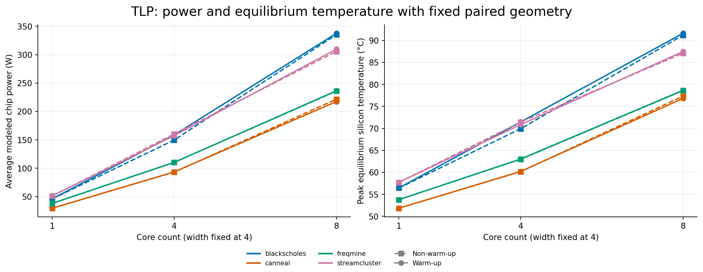

*Comparison figure 5. Paired core-sweep power and equilibrium temperatures.*

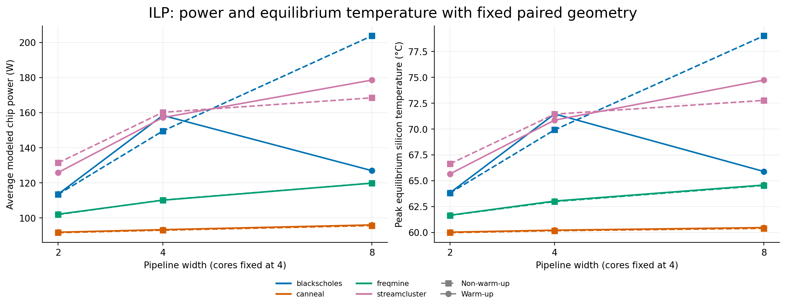

*Comparison figure 6. Paired width-sweep power and equilibrium temperatures.*

Reference static power and component area are equal in every pair. Changes in average chip power therefore come from measured runtime dynamic power, within output precision. Core logic and L1 dominate dynamic changes; equivalent NoC and L2 retain large fixed-reference leakage contributions. The unchanged models use about 76.20 W static at C4/W4 and 188.81 W at C8/W4, including an 85.70 W static equivalent NoC at eight cores.

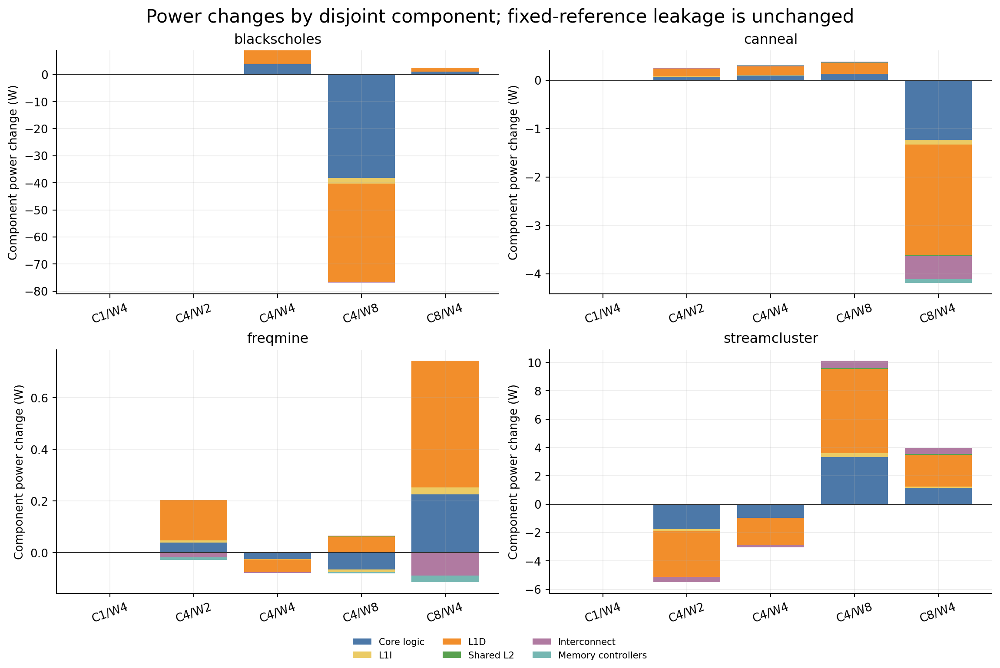

*Comparison figure 9. Signed per-component changes in average power, without parent/child double counting.*

The C4→C8 warm intervals for blackscholes/canneal/freqmine still show more than 2× power growth, while C1→C8 ratios remain below 8. Distinguish proportional `P=kN` from affine `P=a+bN`; neither is established as a universal law by three levels. The blackscholes W4→W8 warm interval has decreasing average power because of lower activity per second, despite greater structural width and static cost. It is not a physical area/power optimization result independent of workload timing.

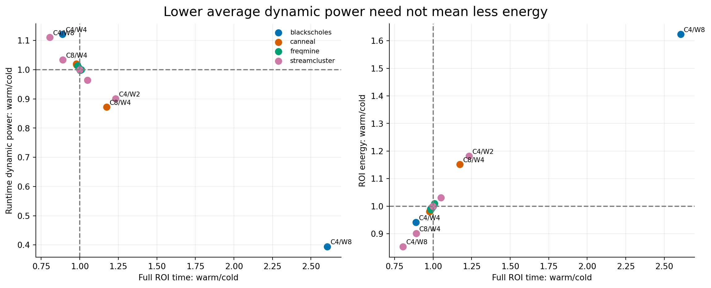

*Comparison figure 10. Paired dynamic power and energy versus time; lower watts can accompany worse energy.*

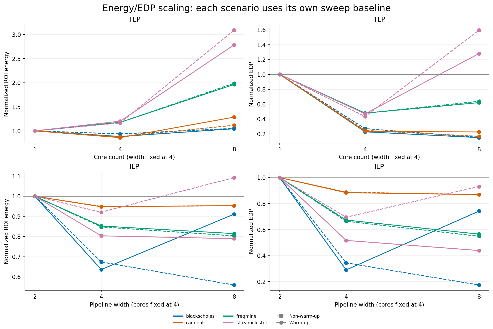

*Comparison figure 7. Each scenario’s normalized energy and EDP curves.*

At eight cores, all four workloads exceed their own one-core ROI energy in both scenarios. Warm-up therefore does not make maximum core count the energy-minimal choice. Canneal's warm W4/W8 energy difference remains small, despite consistent lowest observed energy at W4. EDP can favor a different design because it weights time again.

## 7. Temperature is not a thermal warm-up experiment

Paired floorplans and thermal configs are byte-identical. The HotSpot maximum is computed from named silicon blocks, under 45 °C ambient, fixed package/cooling and indefinitely sustained ROI-average block power. Pre-ROI thermal history is not supplied, so differences are driven by **ROI power distribution under the same paired geometry**, not by simulated heat accumulated during initialization.

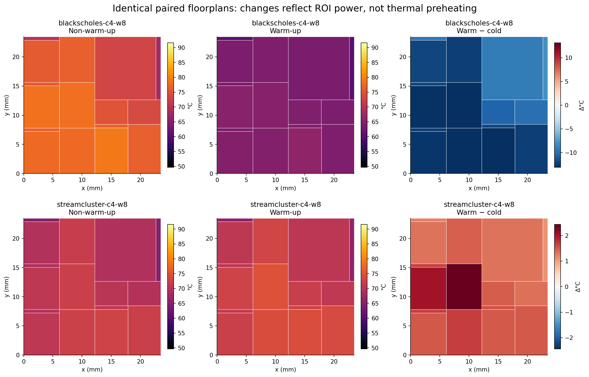

*Comparison figure 12. Identical geometry with cold/warm temperatures and their differences; each delta row has its own labeled scale.*

The largest cooling change is blackscholes C4/W8 at −13.13 °C; streamcluster C4/W8 rises 1.96 °C while becoming faster and using less ROI energy. The warm maximum across the study is blackscholes C8/W4 at 91.62 °C versus 91.19 °C cold. Maximum block temperature depends on distribution as well as total watts; very small changes should also be read against 0.01 K output precision.

These are conditional equilibrium estimates, not peak temperatures reached during millisecond workloads or a real-chip safety-limit assessment. Fixed 350 K leakage, no thermal feedback/throttling, coarse blocks and uncalibrated cooling/layout remain limitations.

## 8. Which configuration is preferred now?

| Workload | Scenario | Fastest | Minimum ROI energy | Minimum EDP |
| --- | --- | --- | --- | --- |
| blackscholes | non_warm_up | blackscholes-c8-w4 | blackscholes-c4-w8 | blackscholes-c4-w8 |
| blackscholes | warm_up | blackscholes-c8-w4 | blackscholes-c4-w4 | blackscholes-c8-w4 |
| canneal | non_warm_up | canneal-c8-w4 | canneal-c4-w4 | canneal-c8-w4 |
| canneal | warm_up | canneal-c8-w4 | canneal-c4-w4 | canneal-c8-w4 |
| freqmine | non_warm_up | freqmine-c8-w4 | freqmine-c1-w4 | freqmine-c4-w8 |
| freqmine | warm_up | freqmine-c8-w4 | freqmine-c1-w4 | freqmine-c4-w8 |
| streamcluster | non_warm_up | streamcluster-c4-w4 | streamcluster-c1-w4 | streamcluster-c4-w4 |
| streamcluster | warm_up | streamcluster-c4-w8 | streamcluster-c1-w4 | streamcluster-c4-w8 |

These are the minima among **five observed designs**, not the unmeasured core×width grid. Blackscholes's energy/EDP preference changes away from C4/W8 because of its warm regression. Streamcluster's fastest/lowest-EDP setting changes from C4/W4 to C4/W8. Canneal/freqmine choices mostly persist. Any small difference needs repetitions before a stable design recommendation; objectives with a strict area/temperature budget may choose differently.

## 9. Initialization coverage and confidence

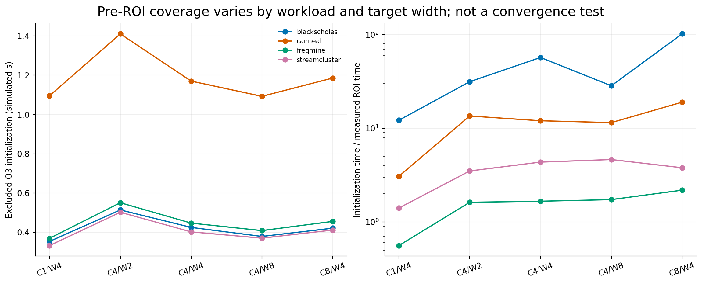

*Comparison figure 11. Excluded initialization time and its ratio to measured ROI time; these are simulated durations.*

Initialization spans roughly 0.332–1.411 simulated seconds and about 0.56–101.91× ROI time. It includes guest setup, data loading and runtime work, varies by target width/workload and is not a calibrated warm-up budget. No excluded-region power estimate was generated, so no end-to-end initialization energy benefit/cost is claimed. Host simulation duration is also not the benchmark performance metric.

All 40 cases passed completed-ROI and converter/thermal provenance checks. Comparison additionally verifies resolved hardware, constant area/leakage/clock, identical thermal geometry/settings, and energy/throughput accounting identities. [Independent checks](data/independent_checks.json) recalculate all 40 raw tick/power measurements, 20 paired effects and 48 scenario-specific sweep rows, and reproduce the original published cold numeric metrics. The combined source manifests hash **560 input artifacts**. See [validation](data/validation.json), [warm input hashes](../warm_up/data/input_sha256.json) and [re-extracted reference hashes](reference/data/input_sha256.json). The original cold report/data remain unchanged.

Both scenarios have 40 total L2 timing warnings each, approximate SIMD/register/cache/directory/network/controller mappings, fixed leakage and no external DRAM/board energy. Three warm and two cold cases have documented cycle bookkeeping notes; exact ROI ticks remain authoritative. Suppressed-zero quiesce counters are handled using the pinned gem5 registration rule, not by silently dropping unknown required counters.

The strongest defensible conclusions are the observed full-program scaling changes and the associated work/active/quiesce behavior under this model. They are not proof that warm-up itself causes a universal gain or slowdown. To strengthen the study, repeat both scenarios for anomalous blackscholes widths, canneal C8 and streamcluster width extremes; verify effective thread placement and collect scheduling/wakeup/synchronization/PC evidence. If identical restores reproduce exactly, repeated copies demonstrate reproducibility rather than independent random-trial variability. Check documented sensitivity to pre-ROI conditioning and execution conditions before assigning confidence intervals or using “steady-state” microarchitecture language. ROI completion also does not independently verify guest output checking after `WORKEND`, where these simulations stop. No new simulations were launched during this analysis.

## 10. Reproduce and inspect

With the raw datasets and matching model/tool binaries available, run from the repository root:

```bash
.venv-analysis/bin/python scripts/analyze_warm_up.py
```

Dependencies are in [requirements-analysis.txt](../../requirements-analysis.txt). This produces the warm report, 23 warm figure sets, 15 comparison figure sets, CSVs and two bundled offline interactive charts. It writes only the two new report directories. `--extract-only` omits figures/reports; `--reuse-extracted` checks recorded source hashes and extractor identity before reusing parsed tables. The current interpretation template describes this v1 dataset and guards its principal anomaly signs; review the narrative if measurements are replaced.

| File | Contents |
| --- | --- |
| [matched_cases.csv](data/matched_cases.csv) | 20 cold/warm pairs with absolute metrics, matched ratios and diagnostic deltas |
| [matched_sweeps.csv](data/matched_sweeps.csv) | 24 matched sweep rows using each scenario’s own baseline |
| [component_changes.csv](data/component_changes.csv) | Component dynamic/static/total power changes |
| [configuration_choices.csv](data/configuration_choices.csv) | Lowest observed time, energy and EDP per workload/scenario |
| [hardware_checks.csv](data/hardware_checks.csv) | Resolved hardware and thermal-input equality per pair |
| [validation.json](data/validation.json) | Policy, tool, model, extractor and analysis-source identities |
| [independent_checks.json](data/independent_checks.json) | Independent raw tick/power arithmetic, sweep-baseline checks and reference reproduction |
| [Warm tables](../warm_up/data/summary.csv) | Full warm ROI metrics, excluded initialization and counter diagnostics |
| [Reference tables](reference/data/summary.csv) | Independently re-extracted cold metrics; original publication is preserved |

### Figure downloads

| Figure | Raster | Vector | Document |
| --- | --- | --- | --- |
| 01_paired_roi_times | [PNG](figures/01_paired_roi_times.png) | [SVG](figures/01_paired_roi_times.svg) | [PDF](figures/01_paired_roi_times.pdf) |
| 02_paired_metric_changes | [PNG](figures/02_paired_metric_changes.png) | [SVG](figures/02_paired_metric_changes.svg) | [PDF](figures/02_paired_metric_changes.pdf) |
| 03_tlp_speedup_comparison | [PNG](figures/03_tlp_speedup_comparison.png) | [SVG](figures/03_tlp_speedup_comparison.svg) | [PDF](figures/03_tlp_speedup_comparison.pdf) |
| 04_ilp_speedup_comparison | [PNG](figures/04_ilp_speedup_comparison.png) | [SVG](figures/04_ilp_speedup_comparison.svg) | [PDF](figures/04_ilp_speedup_comparison.pdf) |
| 05_tlp_power_temperature | [PNG](figures/05_tlp_power_temperature.png) | [SVG](figures/05_tlp_power_temperature.svg) | [PDF](figures/05_tlp_power_temperature.pdf) |
| 06_ilp_power_temperature | [PNG](figures/06_ilp_power_temperature.png) | [SVG](figures/06_ilp_power_temperature.svg) | [PDF](figures/06_ilp_power_temperature.pdf) |
| 07_energy_edp_comparison | [PNG](figures/07_energy_edp_comparison.png) | [SVG](figures/07_energy_edp_comparison.svg) | [PDF](figures/07_energy_edp_comparison.pdf) |
| 08_work_activity_changes | [PNG](figures/08_work_activity_changes.png) | [SVG](figures/08_work_activity_changes.svg) | [PDF](figures/08_work_activity_changes.pdf) |
| 09_component_power_changes | [PNG](figures/09_component_power_changes.png) | [SVG](figures/09_component_power_changes.svg) | [PDF](figures/09_component_power_changes.pdf) |
| 10_dynamic_power_time_energy | [PNG](figures/10_dynamic_power_time_energy.png) | [SVG](figures/10_dynamic_power_time_energy.svg) | [PDF](figures/10_dynamic_power_time_energy.pdf) |
| 11_initialization_coverage | [PNG](figures/11_initialization_coverage.png) | [SVG](figures/11_initialization_coverage.svg) | [PDF](figures/11_initialization_coverage.pdf) |
| 12_paired_thermal_maps | [PNG](figures/12_paired_thermal_maps.png) | [SVG](figures/12_paired_thermal_maps.svg) | [PDF](figures/12_paired_thermal_maps.pdf) |
| 13_blackscholes_active_throughput | [PNG](figures/13_blackscholes_active_throughput.png) | [SVG](figures/13_blackscholes_active_throughput.svg) | [PDF](figures/13_blackscholes_active_throughput.pdf) |
| 14_time_ratio_accounting | [PNG](figures/14_time_ratio_accounting.png) | [SVG](figures/14_time_ratio_accounting.svg) | [PDF](figures/14_time_ratio_accounting.pdf) |
| 15_change_in_scaling_conclusions | [PNG](figures/15_change_in_scaling_conclusions.png) | [SVG](figures/15_change_in_scaling_conclusions.svg) | [PDF](figures/15_change_in_scaling_conclusions.pdf) |
